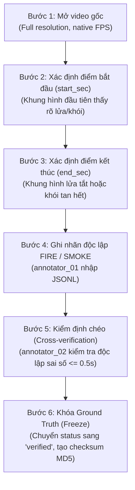

# Hướng Dẫn Quản Lý & Gán Nhãn Sự Kiện Ground Truth Độc Lập
## Đề tài: Phát hiện và cảnh báo cháy từ camera giám sát (DACN_NCKH - Tuần 4)

Tài liệu này quy định cấu trúc dữ liệu, nguyên tắc khoa học và quy trình chuẩn (SOP) để thu thập, gán nhãn, kiểm định chéo và đóng gói tập dữ liệu Ground Truth sự kiện (Event-level Ground Truth) độc lập với các dự đoán của mô hình học máy.

---

## 1. Mục Tiêu & Nguyên Tắc Bắt Buộc

1. **Tính độc lập tuyệt đối:**
   - Ground Truth **không được tạo ra từ kết quả dự đoán của YOLO, ByteTrack hay bất kỳ mô hình AI nào**.
   - Mọi mốc thời gian $[start\_sec, end\_sec]$ phải được người kiểm định (human annotator) quan sát trực tiếp trên tệp video gốc.
2. **Phân tách rõ ràng hai lớp nhãn:**
   - `FIRE` (Lửa/Ánh lửa) và `SMOKE` (Khói) là hai nhãn độc lập.
   - Một video có thể đồng thời có cả 2 sự kiện với khoảng thời gian bắt đầu và kết thúc khác nhau (ví dụ: khói bốc lên trước lúc 1.2s, ngọn lửa bùng phát lúc 13.2s).
3. **Quy định về khoảng thời gian sự kiện $[start\_sec, end\_sec]$:**
   - Bắt buộc: $0 \le start\_sec < end\_sec \le video\_duration\_sec$.
   - **Tuyệt đối không tự gán `end_sec` bằng toàn bộ thời lượng video** nếu đám cháy bị dập tắt, bị khuất hoặc khói đã tan.
   - Nếu chưa có người đối soát khung hình kết thúc cụ thể, nhãn phải được đặt ở trạng thái `verification_status: "pending_verification"`.
4. **Không tự điền nhãn:** Video không có cháy/khói (video âm tính) tuyệt đối không có bản ghi trong tập sự kiện dương tính.

---

## 2. Cấu Trúc Dữ Liệu (Schema)

Tệp dữ liệu lưu trữ tại: [`data/ground_truth/events.jsonl`](file:///d:/workspace/DACN_NCKH/data/ground_truth/events.jsonl). Mỗi dòng là một JSON object:

```json
{
  "video_id": "POS_01",
  "camera_id": "BENCH_POS_01",
  "label": "FIRE",
  "start_sec": 2.4,
  "end_sec": 12.8,
  "confidence": 1.0,
  "annotator_id": "annotator_01",
  "verification_status": "verified",
  "notes": "Ngọn lửa bốc lên tại lò đốt, được dập tắt lúc 12.8s"
}
```

### Chi tiết các trường:
| Trường | Kiểu dữ liệu | Bắt buộc | Mô tả |
| :--- | :---: | :---: | :--- |
| `video_id` | string | Có | Mã định danh video trong `video_dataset_list.csv` (ví dụ: `POS_01`) |
| `camera_id` | string | Có | Mã định danh camera luồng (ví dụ: `BENCH_POS_01`) |
| `label` | string | Có | Nhãn sự kiện: chỉ chấp nhận `"FIRE"` hoặc `"SMOKE"` |
| `start_sec` | float | Có | Giây bắt đầu xuất hiện dấu hiệu cháy/khói ($\ge 0$) |
| `end_sec` | float | Có | Giây kết thúc sự kiện ($> start\_sec$) |
| `confidence` | float | Có | Mức độ tin cậy của nhãn Ground Truth (chuẩn là `1.0`) |
| `annotator_id` | string | Có | Mã người gán nhãn thực hiện (ví dụ: `annotator_01`) |
| `verification_status`| string | Có | Trạng thái kiểm định: `"verified"` hoặc `"pending_verification"` |
| `notes` | string | Không | Ghi chú bổ sung về nguồn gốc hoặc đặc điểm sự kiện |

---

## 3. Quy Trình Gán Nhãn Chuẩn (Annotation Protocol)

Quy trình gán nhãn sự kiện độc lập gồm 6 bước nghiêm ngặt:



1. **Bước 1 - Xem video gốc:** Xem video ở độ phân giải gốc và tốc độ chuẩn, không nén hoặc rescale để tránh mất chi tiết khói mỏng.
2. **Bước 2 - Xác định thời điểm bắt đầu (`start_sec`):** Dừng tại khung hình đầu tiên có đốm lửa/luồng khói có thể nhận biết bằng mắt thường. Ghi lại timestamp chính xác đến $0.1$ giây.
3. **Bước 3 - Xác định thời điểm kết thúc (`end_sec`):** Tìm khung hình mà đám cháy/khói đã chấm dứt hoàn toàn hoặc ra khỏi khung hình camera. Nếu sự kiện tiếp diễn đến hết video, `end_sec` được tính là thời điểm kết thúc video.
4. **Bước 4 - Ghi loại sự kiện:** Phân loại rõ `FIRE` (ngọn lửa bốc cháy) hoặc `SMOKE` (khói bốc lên). Nếu có cả hai, tạo 2 bản ghi riêng biệt.
5. **Bước 5 - Kiểm tra chéo nhãn (Cross-Verification):** Người thẩm định thứ hai (`annotator_02`) đối soát độc lập. Nếu độ lệch $|start_1 - start_2| > 0.5\text{s}$, hai người cùng xem lại để thống nhất.
6. **Bước 6 - Khóa Ground Truth trước khi đánh giá:** Sau khi xác minh, đặt `verification_status = "verified"`, lưu tệp và tính mã băm MD5 để đảm bảo Ground Truth không bị chỉnh sửa trong suốt quá trình benchmark.

---

## 4. Công Cụ Kiểm Tra & Tích Hợp

- **Kiểm tra tính hợp lệ của tệp Ground Truth:**
  ```powershell
  .\.venv\Scripts\python.exe scripts/validate_ground_truth.py --input data/ground_truth/events.jsonl
  ```
- **Nạp Ground Truth trong code đánh giá:**
  ```python
  from src.event_eval import load_ground_truth_events
  
  gt_events = load_ground_truth_events(Path("data/ground_truth/events.jsonl"))
  ```

