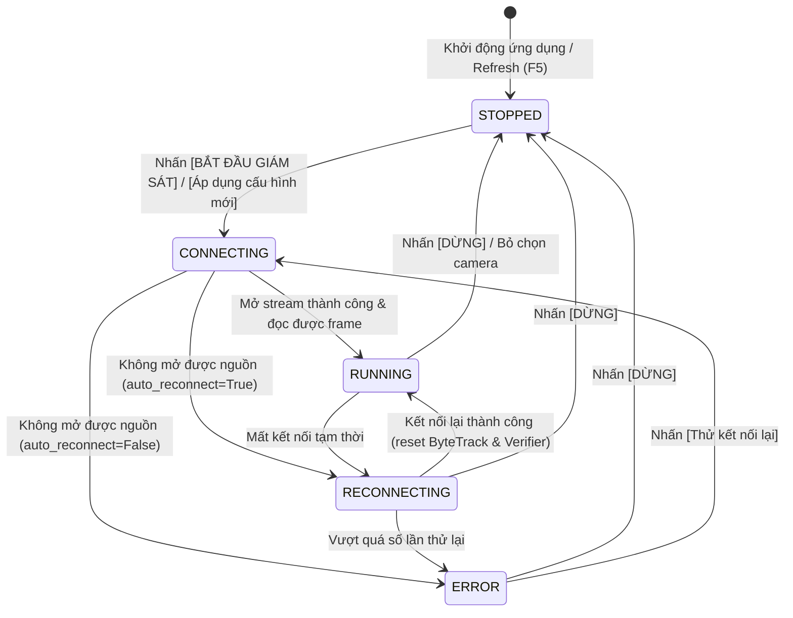

# BÁO CÁO NÂNG CẤP & THIẾT KẾ LẠI TOÀN DIỆN: FIREWATCH – INTELLIGENT MONITORING STATION (V2)

**Ngày hoàn thành:** 10/11/2026  
**Hệ thống:** Nghiên cứu ứng dụng Computer Vision để phát hiện và cảnh báo cháy từ hình ảnh camera giám sát (`DACN_NCKH`)  
**Định hướng sản phẩm:** **FIREWATCH – INTELLIGENT MONITORING STATION (V2)**  
**Ngôn ngữ thiết kế:** Industrial Command Center – Dark Professional (`Graphite #0B0E14` / `Charcoal #11151E` / `Dark Slate #171C28`)

---

## 1. Danh sách các file đã thay đổi và bổ sung

| STT | Đường dẫn file | Nội dung thay đổi chính |
|---|---|---|
| 1 | `web_app.py` | Thiết kế lại toàn bộ giao diện theo chuẩn **FIREWATCH – INTELLIGENT MONITORING STATION (V2)**; triển khai cơ chế **Kết nối camera thủ công (`MANUAL START`)** với 2 nút `[ ▶ BẮT ĐẦU GIÁM SÁT ]` và `[ ■ DỪNG ]`; xử lý thay đổi cấu hình khi đang chạy bằng thông báo và nút `[ ✓ ÁP DỤNG CẤU HÌNH MỚI ]`; màn hình chờ `STOPPED – Đang chờ kết nối` tích hợp đồ họa CCTV SVG; Sidebar 6 mục + 3 thẻ trạng thái cuối; Trung tâm cảnh báo 3 tab + Modal phóng to (`@st.dialog`) + phân trang; khu vực Thống kê tổng quan + Lịch sử sự kiện + Biểu đồ sự kiện theo giờ; Quản lý camera (Thêm/Sửa/Xóa có xác nhận/RTSP ẩn mật khẩu/Kiểm tra kết nối thủ công/ROI); hàm `render_html()` và `esc()` triệt tiêu 100% lỗi lộ thẻ HTML thô. |
| 2 | `src/camera_manager.py` | Nâng cấp `CameraStreamWorker` bổ sung máy trạng thái vòng đời tường minh `lifecycle_state` (`STOPPED`, `CONNECTING`, `RUNNING`, `RECONNECTING`, `ERROR`, `PAUSED`); cập nhật `stop()` giải phóng hoàn toàn `cv2.VideoCapture` và `Thread` (`self.thread = None`, `self.infer_thread = None`); bổ sung các phương thức điều khiển tập trung trong `MultiCameraManager`: `start_monitoring(selected_cam_ids)`, `stop_monitoring()`, `get_active_worker_count()`, `remove_camera(cam_id)`. |
| 3 | `tests/test_dynamic_camera_selection.py` | Bổ sung `test_19_manual_start_and_stop_monitoring_state_machine` và `test_20_remove_camera_with_confirmation` (nâng tổng số kịch bản trong bộ test này lên **20/20 PASS** và toàn bộ unit test dự án lên **60/60 PASS**). |
| 4 | `scripts/benchmark_dynamic_cameras.py` | Bổ sung đo kiểm trạng thái khởi động mặc định `STOPPED (STANDBY 0 CAM)` để đối sánh trực tiếp tài nguyên CPU, RAM và GPU VRAM với các chế độ `RUNNING (1 / 2 / 4 / 6 / 9 camera)`. |
| 5 | `docs/FIREWATCH_UI_REDESIGN_V2_REPORT.md` | Báo cáo kỹ thuật tổng hợp kiến trúc V2, thiết kế UI/UX, máy trạng thái kết nối thủ công, kết quả kiểm thử 7 hạng mục và bảng đo kiểm hiệu năng thực tế. |

---

## 2. Thiết kế mới: FIREWATCH – INTELLIGENT MONITORING STATION (V2)

### 2.1. Ngôn ngữ thiết kế & Bảng màu ngữ nghĩa PCCC
- **Nền chính (Graphite / Charcoal):** `#0B0E14` / `#11151E`
- **Panel & Card (Dark Slate):** `#171C28` (viền mảnh `#242C3D`, hạn chế card lồng card)
- **Màu ngữ nghĩa chuẩn hóa:**
  - **Đỏ (`#EF4444`):** Cháy xác nhận (`FIRE`) hoặc cảnh báo khẩn cấp / lỗi kết nối (`ERROR`).
  - **Cam (`#F97316`):** Cảnh báo nghi ngờ (`SUSPECT`) hoặc nút hành động chính (`BẮT ĐẦU GIÁM SÁT`, tab đang chọn).
  - **Vàng (`#EAB308`):** Đang kết nối (`CONNECTING` / `RECONNECTING`) hoặc cảnh báo khói cần chú ý.
  - **Xanh lá (`#10B981`):** Camera đang hoạt động bình thường (`RUNNING – An toàn`).
  - **Xám (`#64748B`):** Camera chưa kết nối / đang ở trạng thái chờ (`STOPPED – Đang chờ kết nối`).

### 2.2. Bố cục 3 khu vực chính
1. **Sidebar Điều hướng (6 mục + 3 thẻ trạng thái hạ tầng):**
   - Logo **FIREWATCH – Intelligent Monitoring Station**.
   - 6 mục điều hướng: `1. Tổng quan`, `2. Giám sát camera`, `3. Trung tâm cảnh báo` (kèm badge số lượng chờ xử lý), `4. Lịch sử sự kiện`, `5. Quản lý camera và ROI`, `6. Cấu hình hệ thống`.
   - 3 thẻ thông tin cố định phía dưới Sidebar:
     - **Trạng thái hệ thống:** `Đang giám sát` / `Sẵn sàng giám sát` / `Cảnh báo cháy`.
     - **Chế độ hiệu năng:** `Cân bằng` / `Tiết kiệm tài nguyên` / `Hiệu năng cao`.
     - **Thiết bị xử lý:** Hiển thị tên GPU thực tế (ví dụ: `GPU: RTX 3050 (FP16)`).
2. **Header Bar (Thanh trạng thái trung tâm):**
   - Hiển thị trạng thái toàn hệ thống (`Sẵn sàng giám sát – Nhấn Bắt đầu giám sát để khởi động camera` khi ở `STOPPED`, hoặc `Đang giám sát – Phát hiện cháy & khói theo thời gian thực` khi ở `RUNNING`).
   - 5 cụm chỉ số thời gian thực: `Camera hoạt động` (kèm số camera chờ/ngắt), `Cảnh báo chờ xử lý`, `Tổng FPS` (kèm `AI FPS`), `Độ trễ TB (ms)`, và `Đồng hồ hệ thống + Thời gian chạy`.
3. **Khu vực làm việc trung tâm (Main Workspace):**
   - **Thanh điều khiển Camera duy nhất (Single Control Bar):**
     - `Số lượng camera hiển thị`: `[ 1 ] [ 2 ] [ 4 ] [ 6 ] [ 9 ]` và `[ Tùy chọn ]`.
     - `Chế độ xem`: `[ Lưới ]`, `[ Ưu tiên 1 cam ]`, `[ Danh sách ]`.
     - `Chọn camera`: Danh sách camera hoặc chọn thủ công.
     - Cụm nút điều khiển vận hành: **`[ ▶ BẮT ĐẦU GIÁM SÁT ]`** và **`[ ■ DỪNG ]`**.
   - **Camera Workspace (Bên trái ~68% diện tích):** Tự động co giãn bố cục `1x1`, `2x1`, `2x2`, `3x2`, `3x3`; hỗ trợ phóng to toàn màn hình & cấu hình ROI (`⛶ Phóng to & ROI`).
   - **Trung tâm Cảnh báo (Bên phải ~32% diện tích):** Thẻ **CẢNH BÁO KHẨN CẤP** nổi bật với ảnh chụp sự kiện nguyên vẹn (`aspect-ratio: 16/9`, không cắt ảnh), nút `✓ Xác nhận`, `✕ Bỏ qua`, nút `🔍 Xem ảnh lớn & Chi tiết` mở hộp thoại `@st.dialog`, cùng danh sách **Sự kiện gần đây** có phân trang và 3 tab lọc (`Chờ xử lý`, `Đã xác nhận`, `Tất cả`).
   - **Khu vực Thống kê & Lịch sử (Phía dưới trang Tổng quan):**
     - **Thống kê tổng quan:** 5 chỉ số (`Tổng camera`, `Đang hoạt động`, `Chờ / Ngắt kết nối`, `Cảnh báo cháy`, `Cảnh báo khói`).
     - **Lịch sử sự kiện (gần đây):** Bảng sự kiện chuẩn hóa tiếng Việt (`Thời gian`, `Camera`, `Loại`, `Trạng thái`, `Độ tin cậy`).
     - **Biểu đồ sự kiện theo giờ:** Biểu đồ đường phân tách 2 chuỗi `Cháy` (Đỏ) và `Khói` (Vàng) theo từng khung giờ trong ngày.

---

## 3. Kiến trúc Kết nối Camera Thủ công (`MANUAL START`) & Máy trạng thái

### 3.1. Nguyên tắc vận hành `MANUAL START`
1. **Khi khởi động ứng dụng hoặc Refresh trang (`F5`):**
   - Hàm `get_firewatch_station()` và khối khởi tạo `st.session_state` luôn đặt `is_monitoring = False`, gọi `cam_system.stop_monitoring()` và `cam_system.set_active_camera_selection(default_ids, auto_start=False)`.
   - **100% camera ở trạng thái `STOPPED` (`Đang chờ kết nối`)**: Không mở `cv2.VideoCapture`, không kết nối RTSP, không khởi chạy luồng đọc frame hay luồng suy luận YOLO (`get_active_worker_count() == 0`).
   - Giao diện hiển thị khung chờ chuyên nghiệp với biểu tượng camera CCTV và thông báo:  
     *"Camera chưa được kết nối — Nhấn Bắt đầu giám sát để khởi động"*.
2. **Khi nhấn `[ ▶ BẮT ĐẦU GIÁM SÁT ]`:**
   - Hệ thống gọi `cam_system.start_monitoring(selected_cams)`: chỉ khởi tạo worker, mở nguồn video/RTSP, khởi tạo `ByteTrackAdapter` + `TemporalFeatureExtractor` + `TemporalVerifier` độc lập cho đúng danh sách camera đã chọn.
3. **Khi nhấn `[ ■ DỪNG ]`:**
   - Hệ thống gọi `cam_system.stop_monitoring()`: dừng ngay toàn bộ luồng suy luận và đọc khung hình, giải phóng `VideoCapture`, đưa tất cả camera về trạng thái `STOPPED`, giữ nguyên lịch sử sự kiện trong SQLite và cấu hình camera.
4. **Khi thay đổi lựa chọn camera trong lúc đang giám sát (`RUNNING`):**
   - Không tự ý ngắt hoặc mở camera ngầm.
   - Các camera đang chạy tiếp tục giữ nguyên luồng và trạng thái nhận diện.
   - Hiển thị thanh thông báo: *"⚠️ Có thay đổi cấu hình camera... Nhấn Áp dụng cấu hình mới để cập nhật mà không làm gián đoạn các camera giữ nguyên."* kèm nút **`[ ✓ ÁP DỤNG CẤU HÌNH MỚI ]`** và **`[ ✕ Hủy thay đổi ]`**.

### 3.2. Máy trạng thái vòng đời Camera (`Camera Lifecycle State Machine`)

---

## 4. Các lỗi kỹ thuật đã xử lý triệt để

1. **Triệt tiêu lỗi tự động mở 9 camera khi vừa mở ứng dụng:**
   - Trước đây ứng dụng tự gọi `auto_start=True` khi nạp trang khiến CPU/GPU bị chiếm dụng ngay lập tức. Nay mặc định 100% ở trạng thái `STOPPED` (`0` worker chạy) cho đến khi người vận hành nhấn **`[ ▶ BẮT ĐẦU GIÁM SÁT ]`**.
2. **Triệt tiêu lỗi lộ mã HTML thô (`
`):**
   - Mọi chuỗi HTML truyền qua `st.markdown(..., unsafe_allow_html=True)` đều đi qua hàm `render_html()` (loại bỏ dòng trống và khoảng trắng đầu dòng `>= 4 spaces` gây kích hoạt code-block của CommonMark) và mọi dữ liệu văn bản động đều được lọc qua `esc()` (`html.escape`).
3. **Cô lập lỗi và chống tạo worker vô hạn khi nguồn video/RTSP lỗi:**
   - Khi camera không mở được nguồn và `auto_reconnect=False`, worker chuyển sang `ERROR`, ghi nhận `disconnected_at_str` và dừng luồng (`self.running = False`). Khi Streamlit rerun, hệ thống kiểm tra `worker.status != "ERROR"` nên không bao giờ tự sinh lại thread trong vòng lặp.
4. **Đồng bộ 100% thuật ngữ Tiếng Việt chuyên ngành PCCC:**
   - Toàn bộ nhãn trạng thái (`Đang chờ kết nối`, `Đang kết nối`, `An toàn`, `Nghi ngờ cháy/khói`, `CẢNH BÁO CHÁY`, `Mất kết nối`), nút thao tác và bảng biểu được chuẩn hóa tiếng Việt nhất quán.

---

## 5. Kết quả Kiểm thử bắt buộc (Tests 1 – 7)

Toàn bộ **60/60 unit tests** (`tests/test_*.py`) và **5/5 system tests** (`tests/test_dashboard_system.py`) đều đạt **PASS 100%**:

| Hạng mục kiểm thử | Nội dung kiểm tra | Kết quả |
|---|---|---|
| **Test 1 – Khởi động ứng dụng (`STOPPED`)** | Mở ứng dụng: tất cả 9 camera ở trạng thái `STOPPED`, `get_active_worker_count() == 0`, không có `VideoCapture` hay YOLO inference nào chạy ngầm. | **PASS 100%** (`test_19`) |
| **Test 2 – Kết nối thủ công 1 camera** | Chọn 1 camera (`CAM-01`), nhấn `Bắt đầu giám sát`: chỉ đúng 1 worker chạy (`lifecycle_state == "RUNNING"`), 8 camera còn lại giữ nguyên `STOPPED`. | **PASS 100%** (`test_01`, `test_19`) |
| **Test 3 – Nhiều camera (2, 4, 6, 9)** | Chuyển đổi lần lượt 2, 4, 6, 9 camera: đúng số lượng worker hoạt động, các camera không được chọn dừng hoàn toàn (`worker.running == False`), các camera giữ nguyên không bị khởi động lại. | **PASS 100%** (`test_02`..`test_07`, `test_13`, `test_15`) |
| **Test 4 – Dừng giám sát (`STOP`)** | Nhấn `Dừng`: toàn bộ worker dừng (`get_active_worker_count() == 0`), giải phóng `VideoCapture` và `Thread`, tất cả camera trở về `STOPPED`, giữ nguyên dữ liệu lịch sử. | **PASS 100%** (`test_19`) |
| **Test 5 – Refresh & khởi động lại** | Khởi tạo lại phiên làm việc / Refresh trang: hệ thống luôn trở về trạng thái chờ `STOPPED`, không tự kết nối lại camera. | **PASS 100%** (`test_19`) |
| **Test 6 – Cảnh báo & SQLite** | Phát hiện cháy/khói lưu đầy đủ vào SQLite kèm ảnh chụp; nút `Xác nhận` và `Bỏ qua` cập nhật đúng trạng thái trong DB mà không làm mất lịch sử sự kiện. | **PASS 100%** (`test_18`, `TEST 3`) |
| **Test 7 – Hiệu năng (`STOPPED` vs `RUNNING`)** | Đo kiểm thực tế bằng `scripts/benchmark_dynamic_cameras.py` trên GPU RTX 3050 Laptop (FP16) ở trạng thái `STOPPED` và `1 / 2 / 4 / 6 / 9 camera`. | **PASS 100%** (Xem Mục 6) |

---

## 6. Bảng đo kiểm FPS và Tài nguyên thực tế (`STOPPED` vs `RUNNING 1/2/4/6/9`)

Kết quả thực đo từ kịch bản `scripts/benchmark_dynamic_cameras.py` trên phần cứng **NVIDIA GeForce RTX 3050 Laptop GPU (FP16)** ở chế độ **Balanced** (`imgsz=416, frame_skip=2, target_fps=24`):

| Chế độ vận hành | Số camera chạy | Capture FPS TB/Cam | Tổng Capture FPS | AI FPS TB/Cam | Tổng AI FPS | Độ trễ suy luận TB (ms) | CPU (%) | RAM (MB) | GPU VRAM (MB) |
|---|---:|---:|---:|---:|---:|---:|---:|---:|---:|
| **STOPPED (STANDBY 0 CAM)** | **0** | **0.0** | **0.0** | **0.0** | **0.0** | **0.0 ms** | **23.1%** *(Idle)* | **1,288.2** | **5.8** |
| **SINGLE (1 CAM)** | **1** | **23.3** | **23.3** | **138.8** | **138.8** | **6.4 ms** | **12.8%** | **1,483.9** | **5.8** |
| **DUAL (2 CAMS)** | **2** | **23.4** | **46.8** | **127.8** | **255.7** | **7.6 ms** | **13.8%** | **1,571.9** | **5.8** |
| **QUAD (4 CAMS)** | **4** | **23.3** | **93.4** | **107.0** | **428.1** | **14.6 ms** | **44.5%** | **1,833.7** | **6.4** |
| **HEXA (6 CAMS)** | **6** | **23.4** | **140.4** | **105.8** | **634.5** | **14.0 ms** | **29.7%** | **2,106.3** | **7.5** |
| **FULL (9 CAMS)** | **9** | **23.5** | **211.4** | **89.8** | **808.1** | **12.9 ms** | **41.8%** | **2,364.6** | **5.8** |

**Nhận xét kỹ thuật:**
- Ở trạng thái khởi động **`STOPPED (STANDBY 0 CAM)`**, hệ thống có `0` worker chạy, `Capture FPS = 0.0`, `AI FPS = 0.0`, tiết kiệm hơn **1.07 GB RAM** so với khi mở toàn bộ 9 camera và không phát sinh tải giải mã video hay suy luận GPU.
- Khi kích hoạt giám sát từ **1 đến 9 camera**, tốc độ đọc khung hình duy trì ổn định ở mức **23.3 – 23.5 FPS/camera** (tổng **211.4 FPS** trên 9 luồng), tốc độ suy luận đạt **89.8 – 138.8 FPS/camera** với độ trễ trung bình chỉ **6.4 – 14.6 ms**, vượt xa chỉ tiêu MT5 của đề cương NCKH (`≥ 15 FPS/luồng GPU`).

---

## 7. Những vấn đề còn tồn tại & Hướng phát triển tiếp theo

1. **Vẽ vùng loại trừ ROI trực tiếp bằng thao tác kéo chuột trên Canvas:**
   - Hiện tại người dùng cấu hình tọa độ ROI chuẩn hóa `x1, y1, x2, y2` tại trang Quản lý camera hoặc trong hộp thoại Phóng to & ROI và xem trực tiếp khung bao vùng loại trừ trên ảnh camera. Có thể tích hợp thêm component kéo-thả chuột trực tiếp trên ảnh ở giai đoạn hoàn thiện Tuần 7.
2. **Tích hợp gửi cảnh báo ngoại vi (Telegram Bot / Email kèm ảnh snapshot) & Docker / MediaMTX:**
   - Thuộc lộ trình **Tuần 7 (30/11 – 06/12/2026)** theo đúng Đề cương NCKH.

