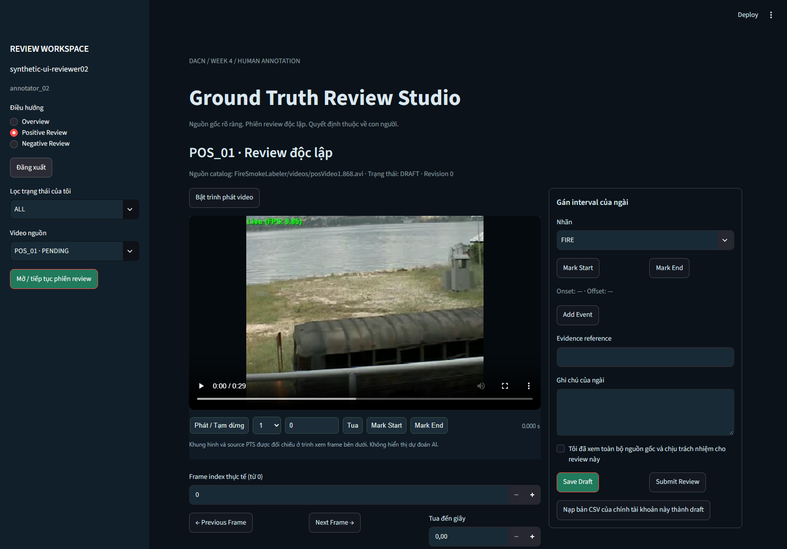

# Ground Truth Review Studio — báo cáo triển khai

Ngày: 13/11/2026, Asia/Saigon. Tôi triển khai ứng dụng local độc lập cho ngài; không sửa dashboard camera hoặc pipeline inference.

## Branch và HEAD

- Branch `fix-4`, HEAD trước triển khai `0c13477dd77dde56effeb9b706cdbcedf2549008`, khớp baseline yêu cầu. Không commit/push.
- Ban đầu có hai thư mục untracked của ngài: `week4_recovery_toolkit/`, `runs/benchmarks/week4_assisted_recovery/`. Tôi đọc phần schema/adapter cần thiết, không sửa chúng.
- Code Studio và tests mới đang ở working tree; kết quả chạy không được gắn nhầm thành CI PASS của HEAD. Không triển khai cloud.

## Tệp đã kiểm tra

`data/ground_truth/README.md`, events hiện hành, snapshot v1.1/checksum; negative manifest và positive catalog; `src/ground_truth_integrity.py`, `event_eval.py`, `week4_acceptance.py`; script recovery và GT/camera acceptance tests hiện có; positive review queue; audit/inference reconciliation hiện tại; `requirements.txt`.

Tôi đọc schema và số dòng của cả năm CSV trong `D:\workspace\week4_private_human_review`, cùng protocol và preparation status. Positive reviewer form có 24 video, adjudication có 35 event; ba negative form có 79 dòng mỗi file. `review_preparation_status.json` ghi số review được script thực hiện là 0, không được hiểu như human signoff.

Mapping thực tế: 24 positive lấy filename từ catalog và fallback hợp lệ tới `FireSmokeLabeler/videos/<file_name>`; không giả định `POS_01.avi`. Có **24/24 positive và 63/79 negative source**, tổng 87/103. CSV gốc có alias khác không bị tự sửa.

README GT lịch sử có claim v1.0 “35 verified”; Studio không dùng claim đó để thẩm định. Snapshot v1.1 đã xác minh checksum vẫn ghi 24 pending và 11 cross_verified lịch sử, chưa có chứng từ độc lập mới được xác thực.

## Kiến trúc và tệp tạo mới

| Tệp | Vai trò |
|---|---|
| `ground_truth_studio/app.py` | Entry point Streamlit, overview, positive/negative review, adjudication, export |
| `config.py`, `settings.example.json` | Private directory configurable, path confinement, tìm FFmpeg/ffprobe |
| `models.py` | Stable event UUID, validation onset/offset/frame/source, matching một-một ngưỡng 0.5s |
| `video_service.py` | Source SHA, PTS, exact ordinal decode, MP4 proxy riêng, HTTP Range 64 KiB |
| `annotation_service.py` | Draft, submit, validate semantic, import own CSV thành draft |
| `review_repository.py` | SQLite WAL, account/token/role, revision conflict, CSV snapshots, backup |
| `adjudication_service.py` | Phân xử có evidence, explicit omissions, không lấy trung bình thời gian |
| `export_service.py` | Versioned candidate bundles, schema adapter, provenance, exposure gates |
| `admin.py` | Operator cấp tài khoản thực và chủ động chấp nhận snapshot CSV ngoài |
| `player/index.html` | Native video controls, tốc độ/seek/mark liên kết Streamlit, không cần npm |
| `README.md`, `EXPORT_SCHEMA.md`, `requirements.txt`, `__init__.py` | Hướng dẫn, hợp đồng export và dependency specification |

Tests mới: `tests/gt_studio_fixtures.py`, `test_gt_studio_video.py`, `test_gt_studio_annotations.py`, `test_gt_studio_independence.py`, `test_gt_studio_adjudication.py`, `test_gt_studio_integrity.py`, `test_gt_studio_ui.py`.

Tệp tracked sửa duy nhất: `.gitignore`, để tránh commit DB/runtime private. Báo cáo này và bằng chứng mới nằm trong `runs/benchmarks/ground_truth_studio/`; manifest bàn giao liệt kê/hash chính xác các tệp. `src/`, `scripts/`, app/dashboard camera, workflow, model checkpoint, GT frozen, video nguồn và artifacts benchmark cũ không bị sửa.

SQLite có users, auth_sessions, videos, review_sessions, review_heads, adjudications, csv_snapshots, audit_log và exports. Submission khóa bằng trigger; REQUIRE_REVIEW tạo draft mới, giữ nguyên phiên đã submit. Role cố định theo tài khoản, không dựa vào display name. User-facing methods kiểm tra opaque token phía backend.

## Các tính năng đã triển khai và kiểm chứng

- Dark UI, thống kê thật từ catalog/snapshot/DB. Tách claim lịch sử, review trong Studio, semantic consensus và exposure đủ điều kiện.
- Positive/negative video selection; bộ lọc trạng thái riêng reviewer; source-frame navigation, seek theo timestamp, Mark Start/End, add/edit/delete draft; stable event ID được giữ khi edit.
- Video gốc được decode độc lập với player proxy; không import detector hoặc đọc inference boxes để gán nhãn. Player stream từng khối, không tải cả video vào RAM.
- PTS ưu tiên ffprobe. Thiếu/không hợp lệ/timeout ghi rõ ESTIMATED_FRAME_INDEX_OVER_FPS, không dùng FPS để khẳng định timing VFR. Exact frame access decode theo ordinal; không dùng CAP_PROP_POS_FRAMES để giả định VFR seek chính xác.
- Hai reviewer có login/vai trò/session riêng. Reviewer 02 không thấy review 01, historical GT, adjudication hoặc predictions, kể cả sau submit. Chỉ adjudicator được xem hai lượt đã khóa và lịch sử.
- Một person ID không được cấp hai account; operator phải tự xác minh người thật và lưu identity reference. Không coi cấu hình tài khoản là chứng minh tuyệt đối về tính độc lập con người.
- Onset/offset lệch >0.5s, khác class hoặc thiếu event được ghi DISPUTED. Event mới được hỗ trợ; missing historical event cần explicit disagreement. Không trung bình timestamp để ép đồng thuận.
- Negative có FIRE/SMOKE hoặc UNCERTAIN intervals không thể cùng lúc được đánh VERIFIED_NEGATIVE. Một quyết định negative cá nhân chưa đủ cho FAR.
- Save Draft bền vững, resume sau restart, optimistic revision chống ghi đè từ hai process; submit yêu cầu evidence và lời xác nhận do người dùng chủ động chọn.
- CSV hiện có được snapshot, không ghi ngược. Chỉ nạp dữ liệu CSV thuộc chính tài khoản thành draft, giữ ID khi có, không tự dùng signoff cũ để submit. External file thay đổi chặn export cho đến khi operator đối soát và chủ động snapshot lại.
- Export tạo thư mục UUID mới kèm backup; giữ năm schema CSV hiện có, thêm positive reviewer 01, summary, candidate JSONL và provenance. Candidate luôn pending_verification; loader hiện tại đọc được với only_verified=False và loại khi only_verified=True.
- Eligible negative exposure chỉ cộng khi dual negative submissions + ACCEPT + source hash + strict technical conditions đều đạt. NEEDS_REVIEW không được coi NORMAL_EOF; inference alignment thiếu vẫn chặn exposure.

## Kết quả chạy thực tế

Môi trường: Windows, Python 3.11.9, Streamlit 1.66.1, OpenCV 5.0.0, NumPy 2.4.6; FFmpeg/ffprobe portable hiện có trong `.tools/ffmpeg`. Không thêm dependency nặng, không tải checkpoint, không train/retune. SQLite và HTTP server dùng standard library.

| Kiểm tra | Kết quả thực tế | Bằng chứng |
|---|---|---|
| `python -m compileall -q ground_truth_studio` | PASS, exit 0 | Đã chạy trên source |
| `python -m unittest discover -s tests -p "test_gt_studio_*.py" -v` | **27 PASS**, 0 FAIL/ERROR/SKIP, exit 0 | `targeted_final.log`, `test_results.json` |
| `python -m unittest discover -s tests -p "test_*.py" -v` | **238 PASS**, 0 FAIL/ERROR/SKIP, exit 0 | `full_suite.log`, `test_results.json` |
| Luồng UI AppTest mở rộng chạy riêng sau đó | **1 PASS**, exit 0; login → positive mark/edit/delete/save → negative FIRE submit → adjudication → export | `ui_complete_flow.log`, `ui_complete_flow_result.json` |
| Export integrity sau khi siết read snapshot | **6 PASS**, exit 0; summary và candidate lấy cùng snapshot reviews/adjudications | `export_final_verification.log`, `export_final_verification_result.json` |
| Real-source AppTest POS_01 | 1 image, không UI error/exception; 0 annotation event, không submit | `ui_real_source_final.json` |
| Streamlit HTTP trên Windows | HTTP health 200 tại loopback port 8514 | Preview đã khởi chạy bằng entry point thật |
| Chrome headless, source POS_01 | Login thành công, video readyState=4, duration=29.3s, không codec error | `browser_result.json` |
| Play/Pause/speed/seek trên source thật | 1.5×, seek=1.2s, phát tới 1.8027s rồi pause; không tạo annotation | `playback_result.json` |
| Private directory thật | Khởi tạo SQLite; đọc 5 CSV; hash trước/sau giống nhau; 0 account được agent tạo | `private_initialization.json` |
| Linux/CI | NOT TESTED cho Studio trong lượt này | Không suy ra từ Windows PASS |

Luồng UI chạy riêng là kiểm tra bổ sung của cùng một test case được mở rộng, không cộng thêm thành 239 test. Sau full suite, tôi siết transaction đọc của export để summary và candidate dùng cùng snapshot, rồi chạy lại 6 integrity test và luồng UI hoàn chỉnh; không coi đó là một lượt full suite mới. Các test automated dùng video/review fixture tổng hợp; test real source chỉ đọc/phát video, không gán nhãn thật.

Tests bao phủ 24 positive/79 negative entries, missing/corrupt media, SHA mismatch, exact forward/backward frame, VFR thật do FFmpeg tạo, thiếu PTS, onset/offset/class, FIRE+SMOKE, event mới/thiếu, role/identity boundaries, draft/resume, immutable submissions, adjudication evidence, external CSV conflicts, candidate compatibility, strict exposure, hai process thực cùng ghi, HTTP Range, logout capability và traversal/injection.

Screenshot giao diện thực, dùng account test trong private test directory cách ly:



Đây là QA UI với source POS_01, không phải bằng chứng người đánh giá thực đã review hay ký xác nhận. `studio_login.png` lưu màn hình login; `studio_review.png` lưu viewport desktop ổn định. Preview/browser test do agent mở được dừng khi bàn giao, không can thiệp process dashboard của ngài.

## Lỗi phát hiện và sửa

| Lỗi/nguyên nhân | Ảnh hưởng | Sửa | Kiểm tra lại |
|---|---|---|---|
| SQLite context manager không tự close connection backup | Windows giữ tệp backup, test teardown lỗi WinError 32 | Dùng closing cho cả source/destination connection | Test export đổi tên backup ngay được; full suite PASS |
| Decision CSV FIRE/SMOKE khác tên UI CONTAINS_FIRE/CONTAINS_SMOKE | Import own negative draft có thể không khớp dropdown | Adapter mapping explicit; không dùng signoff để submit | Test own external FIRE draft PASS |
| Test UI chọn radio theo vị trí; adjudication có thêm radio | Test harness chọn nhầm final-event source khi chuyển sang Export Report | Chọn navigation theo label, giữ nguyên assertion | Luồng UI đầy đủ PASS, log lỗi đầu được giữ riêng |
| Probe UI ban đầu dùng tên element legacy `imgs` | Counter ban đầu ghi 0 dù image đang hiển thị | Dùng element `image` của Streamlit hiện tại | Real-source final probe xác nhận 1 image; screenshot thật |
| CSV JSON malformed / non-finite timestamp / duplicate interval | Có thể tạo draft không hợp lệ hoặc lỗi seek | Validation explicit; reject chứ không tự sửa dữ liệu | Regression validation và VFR/seek PASS |

Lượt test đầu: 21 test, 1 ERROR teardown backup; log `targeted_initial.log` được giữ nguyên. Lỗi UI harness và cleanup do lỗi đó được giữ ở `ui_complete_flow_failed_initial.log`. Không xóa log thất bại để thay bằng tuyên bố chỉ có PASS.

## Tiến độ GT và trạng thái nghiệm thu

**Engineering local Windows: PASS cho chức năng đã chạy ở trên.** Chưa kiểm chứng Linux, CI, stress nhiều người dùng hoặc mọi codec/dung lượng video; không khẳng định các phần đó PASS.

**Scientific Ground Truth: BLOCKED_HUMAN_REVIEW.** Trong private directory thật sau khởi tạo:

- 0 tài khoản do agent tạo, 0 review session/submission/adjudication của production.
- 0 event được người thật tái xác minh qua Studio; 0 giờ negative exposure đủ điều kiện.
- Snapshot giữ nguyên 35 events, gồm 24 pending và 11 claim cross_verified lịch sử.
- Không tạo human signoff, không tự xác minh 11 claim cũ, không thay snapshot v1.1, checkpoint, Operating Point hoặc kết quả lịch sử.

Actual database ở `D:\workspace\week4_private_human_review\ground_truth_studio.sqlite3` chỉ được khởi tạo schema, video catalog và snapshots CSV. Test accounts/drafts nằm trong vùng test cách ly hoặc TemporaryDirectory, không nằm trong database production. Các tệp CSV, protocol và preparation status gốc vẫn nguyên vẹn.

## Giới hạn còn lại

- Chưa có autosave theo timer: người dùng phải Save Draft trước khi đóng/chuyển phiên; bản nháp đã Save mới được bảo đảm resume. Các thao tác sửa/xóa chỉ áp dụng draft của chính người dùng.
- Backward seek xa decode lại từ đầu để giữ ordinal chính xác, nên có thể chậm ở video dài. PTS probe có timeout 180s; proxy AVI có timeout 600s và cần dung lượng cache private.
- MP4 được stream nguyên nguồn; codec không hỗ trợ trên browser có thể không phát được. Trình xem frame OpenCV vẫn dùng source; lỗi codec không chuyển thành video hợp lệ.
- Không có chứng minh sinh trắc học, chữ ký số con người hoặc sandbox filesystem theo từng reviewer. Identity evidence, nguồn gốc video và môi trường review độc lập phải do người quản lý thực hiện/kiểm tra.
- Imported external reviews được giữ và có thể nạp thành draft của chính tài khoản; không tự công nhận progress ngoài Studio là verification mới. Với dữ liệu ngoài khác schema phải đối soát, không silently merge.
- Duration khi không có duration của frame cuối dùng last-frame delta/metadata và được ghi provenance. Không dùng phép ước lượng này để vượt qua gate audit/inference còn thiếu.
- Candidate cần người phụ trách phê duyệt chuyển version. Event mới hoặc bất đồng với lịch sử không bị ép vào schema approval cũ chỉ để làm bộ recovery báo PASS.

## Hướng dẫn bàn giao cho người review

Đọc [README Studio](../ground_truth_studio/README.md) và [export schema](../ground_truth_studio/EXPORT_SCHEMA.md). Người quản lý cấp ba tài khoản theo danh tính thực bằng CLI, không dùng account test trong screenshot. Sau đó mỗi người đăng nhập vai trò riêng, xem source độc lập, Save Draft, ghi evidence và tự Submit Review. Adjudicator chỉ phân xử sau hai submission; explicit disagreement cho missing event và ghi lý do/evidence.

Lệnh entry point đã triển khai và chạy thành công:

```powershell
python -m streamlit run ground_truth_studio/app.py
```

Khuyến nghị chạy local cạnh dashboard hiện tại:

```powershell
python -m streamlit run ground_truth_studio/app.py --server.address 127.0.0.1 --server.port 8514
```

Nếu cần cài dependencies, dùng `python -m pip install -r ground_truth_studio/requirements.txt`. Tạo tài khoản bằng `python -m ground_truth_studio.admin create-account` với các tham số trong README; mật khẩu nhập kín. Không dùng tên ví dụ như chứng từ xác nhận danh tính.

Tôi bàn giao phần mềm và bằng chứng chạy, không tuyên bố hoàn tất annotation hoặc nghiệm thu khoa học Tuần 4.
