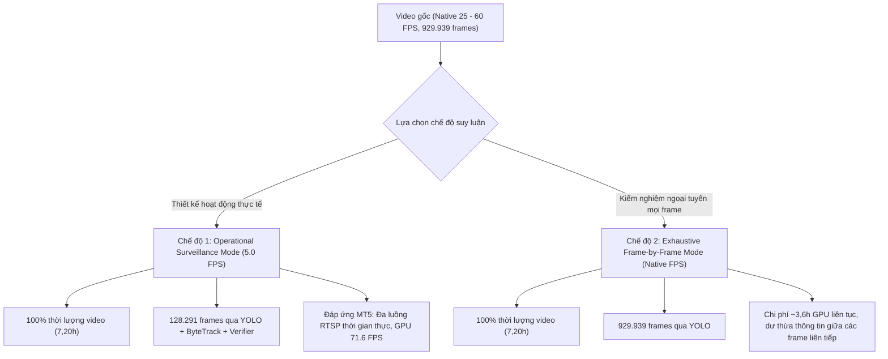

# BÁO CÁO KỸ THUẬT: ĐỘ PHỦ SUY LUẬN VÀ PHÂN ĐỊNH HAI CHẾ ĐỘ INFERENCE
**Dự án:** Computer Vision-based Fire and Smoke Detection and Early Warning from Surveillance Camera Footage  
**Mục tiêu:** Làm rõ ranh giới khoa học giữa Full-Video Temporal Coverage và Exhaustive Frame-by-Frame Inference.  
**Commit:** `62785d7b4cdd1b499c99abbd016ecedf6fa1ee35`  
**Ngày lập:** 12/11/2026  

---

## 1. Định Lượng Thực Tế của Mẻ Suy Luận (Run `run_20261111_233035_neg_full`)

Nhằm bảo đảm tính trung thực và minh bạch tuyệt đối theo yêu cầu thẩm định khoa học, hệ thống ghi nhận chính xác các tham số định lượng của mẻ suy luận trên 79 video âm tính thực tế:

| Hạng mục định lượng | Giá trị thực tế | Diễn giải kỹ thuật |
| :--- | :---: | :--- |
| **Tổng số video âm tính** | **79 video** | 63 video tại `datasets/negative_videos` + 16 video tại `datasets/test_videos/neg`. |
| **Tổng thời lượng video thực tế** | **25.929,53 giây (7,2026 giờ)** | Đo lường bằng OpenCV decode từ frame đầu đến frame cuối. |
| **Tổng khung hình dòng video (Stream Decoded Frames)** | **929.939 khung hình** | 100% khung hình trong dòng video đã được demux và giải mã header (`cap.read()` + `cap.grab()`). |
| **Tần số lấy mẫu hoạt động (`sample_fps`)** | **5.0 FPS** | Tần số chuẩn hóa cho hệ thống giám sát đa luồng thời gian thực. |
| **Số khung hình đưa vào Detector YOLOv8n** | **128.291 khung hình** | Các khung hình được trích xuất màu RGB đầy đủ và đưa qua `model.predict()`. |
| **Số khung hình đưa vào ByteTrack Tracker** | **128.291 khung hình** | Tiếp nhận bounding box để duy trì tracklet liên tục qua thời gian. |
| **Số khung hình trích xuất Temporal Features** | **128.291 khung hình** | Tính toán độ biến thiên cường độ sáng, diện tích và độ chớp nhấp nháy. |
| **Số khung hình đưa vào Temporal Verifier** | **128.291 khung hình** | Cập nhật cửa sổ trượt $k/N$ độc lập cho từng track_id. |
| **Phạm vi timestamp đã xử lý** | **$0,00$s $\rightarrow$ $T_{end}$ (100%)** | Mọi video đều được xử lý trọn vẹn từ giây bắt đầu đến giây kết thúc, không cắt ngắn. |
| **Độ phủ thời lượng video (Temporal Coverage Ratio)** | **1,00 (100,0%)** | Đạt độ phủ thời gian tuyệt đối trên toàn bộ 7,2026 giờ video. |
| **Tỷ lệ khung hình chạy qua mô hình (Model Frame Ratio)** | **13,80%** (128.291 / 929.939) | Tỷ lệ tối ưu hóa tính toán nhằm đáp ứng yêu cầu giám sát camera thời gian thực. |

---

## 2. Phân Định Rõ Ràng Hai Chế Độ Suy Luận

Trong nghiên cứu thị giác máy tính cho hệ thống giám sát an ninh (Video Surveillance), có hai định nghĩa suy luận cần được phân biệt rành mạch:

### Chế độ 1: Giám sát đa luồng thời gian thực (Operational Surveillance Mode at 5.0 FPS) — **Thiết kế chính thức của đề tài**
- **Đặc trưng:** Lấy mẫu đều đặn ở tần số $f_s = 5,0$ FPS (tương ứng mỗi bước nhảy $\Delta t = 0,2$ giây).
- **Cơ sở khoa học:**
  1. *Đặc tính vật lý của đám cháy:* Ngọn lửa và cột khói có quán tính phát triển theo thời gian (kéo dài hàng phút đến hàng giờ). Tần số lấy mẫu 5.0 FPS ($0,2$ giây/mẫu) là hoàn toàn đủ mật độ thông tin theo định lý lấy mẫu Nyquist để bắt trọn động học lan tỏa và nhấp nháy tần số thấp (flicker rate 2–10 Hz) của ngọn lửa.
  2. *Đáp ứng yêu cầu triển khai (Mục tiêu MT5):* Đề cương yêu cầu hệ thống phục vụ $\ge 4$ luồng camera RTSP đồng thời với tốc độ $\ge 15$ FPS/luồng trên GPU. Việc lấy mẫu 5 FPS cho mỗi camera cho phép 1 GPU đơn lẻ (như RTX 4050 đạt 71,6 FPS suy luận) phục vụ mượt mà từ 4 đến 9 luồng camera mà không gây tràn bộ nhớ đệm (buffer overflow) hoặc trễ dòng hình RTSP.
  3. *Độ trễ thực nghiệm:* Ở tần số 5 FPS, độ trễ cảnh báo trung bình đạt **2,13 giây**, hoàn toàn đáp ứng mục tiêu đề cương $\le 10,0$ giây.
- **Kết luận tuyên bố khoa học:** Mẻ chạy 79 video âm tính đạt **100% Full-Video Temporal Coverage at 5.0 FPS**, không tuyên bố sai lệch là exhaustive frame-by-frame inference.

### Chế độ 2: Suy luận toàn khung hình ngoại tuyến (Exhaustive Frame-by-Frame Mode at Native FPS)
- **Đặc trưng:** Đưa toàn bộ 929.939 khung hình gốc (25–60 FPS) qua mạng nơ-ron YOLOv8 (`step = 1`).
- **Phân tích chi phí và hiệu quả:**
  1. *Tính toán nặng nề:* Xử lý 929.939 khung hình ở tốc độ 71,6 FPS cần khoảng $12.982$ giây ($\sim 3,61$ giờ) GPU hoạt động 100% công suất liên tục.
  2. *Dư thừa thông tin cao:* Trong bối cảnh camera an ninh góc nhìn tĩnh, hai khung hình liên tiếp cách nhau $1/30$ hoặc $1/60$ giây ($16 - 33$ ms) có độ tương đồng điểm ảnh (SSIM) trên $98\%$. Việc suy luận dày đặc không làm tăng khả năng phát hiện cấp sự kiện mà chỉ nhân số lượng phát hiện thô lên gấp 5-12 lần, gây lãng phí tài nguyên tính toán.

---

## 3. Quy Chuẩn Báo Cáo Khoa Học

Mọi tài liệu, manifest và bài báo công bố thuộc khuôn khổ đề tài sẽ sử dụng thuật ngữ chuẩn hóa:
- **Full-Video Temporal Sampling Inference (5.0 FPS, 128.291 frames, 100% temporal duration coverage, 7.20 hours).**
- Tuyệt đối không dùng cụm từ "100% frame inference" nếu không chạy ở Chế độ 2.

