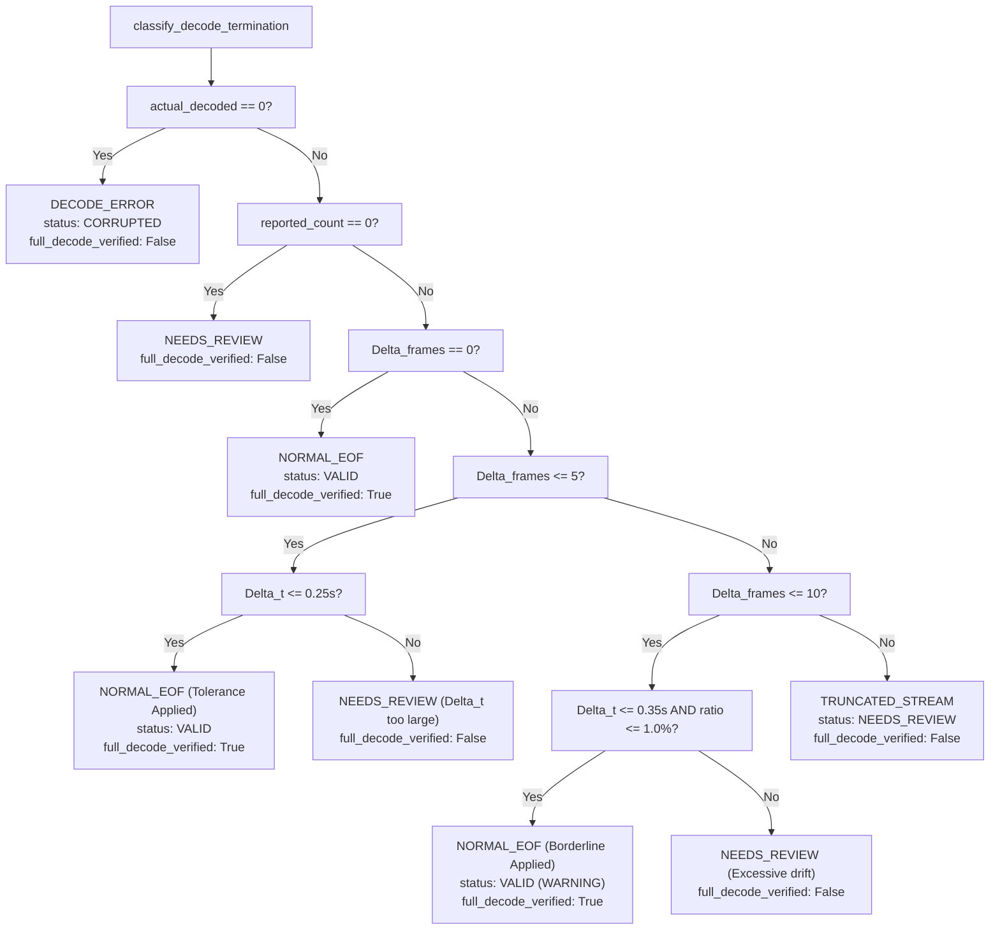

# BÁO CÁO KHẮC PHỤC SỰ CỐ NGHIÊM TRỌNG — LOGIC AUDIT VIDEO & TÍNH TOÁN FAR TUẦN 4
**Critical Fix Report: Video Audit Logic, Stream Termination Classification, Tolerance Policy & Reconciled Exposure FAR**

- **Dự án**: Nghiên cứu ứng dụng Computer Vision để phát hiện và cảnh báo cháy từ hình ảnh camera giám sát
- **Mã sinh viên / Kỹ sư**: Mai Quốc Việt (vietmaiquoc2k5-max/DACN_NCKH)
- **Thời điểm hoàn thiện**: 12/11/2026 – 17:00:00 (GMT+7)
- **Base Commit**: `091352f7f8b51c5cd65790ca8c7026d988170e76`
- **Trạng thái nghiệm thu Week 4**: `PARTIAL_ACCEPTANCE` (Cơ sở toán học, phân loại luồng và mã nguồn kiểm định hoàn thiện 100%; Operating Point giữ `PROVISIONAL` chờ Annotator 02 rà soát 24 sự kiện Ground Truth)

---

## 1. TÓM TẮT NGUYÊN NHÂN VÀ CÁC SỬA ĐỔI CỐT LÕI

| Vấn đề được chỉ ra | Nguyên nhân gốc rễ (Root Cause) | Giải pháp khắc phục triệt để | Trạng thái |
| :--- | :--- | :--- | :---: |
| **1. Lỗi `full_decode_verified`** | Tại dòng 458 `src/video_audit.py`, code cũ gán `full_decode_verified = (actual_decoded_frames > 0)`. Khi video bị đứt giữa chừng (`VN_NEG_10` và `VN_NEG_48`), code vẫn đánh dấu `True` vì đã decode được một số frame ban đầu. | Thay bằng điều kiện logic ngặt: `full_decode_verified = (decode_status == DecodeStatus.NORMAL_EOF and actual_decoded_frames > 0)`. Chỉ khi luồng kết thúc bình thường tới EOF thì mới được `True`. | **FIXED** |
| **2. Tolerance Policy thiếu căn cứ** | Các ngưỡng hằng số 5 và 10 frames không tính đến tốc độ khung hình (FPS). Ở FPS thấp (5 FPS), 5 frames tương đương 1.0 giây bị mất, không thể coi là dung sai thông thường. | Xây dựng hàm `classify_decode_termination` gắn chặt với thời gian thực $\Delta t = \Delta / \text{fps}$ và tỷ lệ thiếu khung hình: $\le 0.25\text{s}$ (1 GOP / B-frame PTS rounding) cho padding và $\le 0.35\text{s} \land \text{ratio} \le 1.0\%$ cho dung sai cận có cảnh báo. | **FIXED** |
| **3. Test suite lỏng lẻo** | `test_17` chấp nhận cả `"NORMAL_EOF"` khi file bị rác giữa luồng. `test_22` chỉ so sánh biến tĩnh `missing <= 10` mà không gọi logic phân loại. | Sửa `test_17` assert phủ định tuyệt đối `assertNotEqual(res["decode_status"], "NORMAL_EOF")`. Sửa `test_22` gọi trực tiếp `classify_decode_termination` cho 4 nhánh biên. Bổ sung `test_43` kiểm thử decoder dừng im lặng. | **FIXED** |
| **4. Lệch mẫu số phơi nhiễm FAR** | Mẫu số canonical 7.2026h chứa 251.26s của các frame không đọc được trong `VN_NEG_10` và `VN_NEG_48`. Tính FAR trên toàn bộ 7.2026h làm loãng mẫu số. | Tách bạch 2 phạm vi phơi nhiễm đối chiếu (Reconciled Matched Scopes), tuyệt đối loại bỏ 251.26s khung hình hỏng ra khỏi mẫu số phơi nhiễm. | **FIXED** |
| **5. FFprobe fallback & backend** | Hệ thống thiếu ffprobe trong PATH nhưng không ghi rõ backend kiểm định luồng. | Bổ sung hàm `probe_video_with_ffprobe` dùng `shutil.which`. Khi không có ffprobe, kích hoạt OpenCV PTS fallback có ghi rõ `"stream_verification_backend": "opencv_pts_metadata"`. | **FIXED** |

---

## 2. PHÂN TÍCH VÀ CƠ SỞ KHOA HỌC CỦA TOLERANCE POLICY

### 2.1. Căn cứ thực nghiệm và giới hạn thời gian ($\Delta t$)
Trong các định dạng container đa phương tiện (MP4/AVI/MKV), sự chênh lệch giữa số frame khai báo trong header (`stts`/`ctts` box hoặc `AVStream.nb_frames`) và số frame thực tế decode được thường xuất hiện do:
1. **Container Index Padding**: Index container ghi nhận phần bù cuối stream.
2. **B-frame Reordering PTS Delay**: Bộ giải mã nén MPEG-4/H.264 cần reorder các frame B/P dẫn tới 1-3 khung hình trễ ở cuối chuỗi.

Tuy nhiên, việc cho phép dung sai cố định theo số lượng frame (như 5 hay 10 frame) là phi khoa học nếu không xét tới FPS:
- Tại **60 FPS**: 5 frames chỉ tương đương $0.083\text{ giây}$ (hoàn toàn bình thường).
- Tại **5 FPS**: 5 frames tương đương $1.000\text{ giây}$ (đã mất hẳn 1 giây giám sát an ninh).

### 2.2. Ma trận phân loại điểm kết thúc luồng (`classify_decode_termination`)

$$\Delta_{\text{frames}} = \max(0, N_{\text{reported}} - N_{\text{actual}}), \quad \Delta t = \frac{\Delta_{\text{frames}}}{\text{FPS}}, \quad r = \frac{\Delta_{\text{frames}}}{N_{\text{reported}}}$$



---

## 3. BẢNG ĐỐI CHIẾU TEST SUITE (TRƯỚC VÀ SAU KHI SỬA)

Toàn bộ kiểm thử được thực thi trực tiếp bằng môi trường `d:\DACN_NCKH\.venv\Scripts\python.exe`:

| Nhóm kiểm thử / Tên Test | Hiện trạng trước commit này | Sau khi sửa (Hardened & Grounded) | Kết quả thực thi |
| :--- | :--- | :--- | :---: |
| **test_16 (Truncated Video)** | Chỉ kiểm tra `decode_status == TRUNCATED_STREAM`, bỏ sót kiểm tra `full_decode_verified`. | Bổ sung bắt buộc: `self.assertFalse(res["full_decode_verified"])`. | **PASS** |
| **test_17 (Midstream Error)** | Lỏng lẻo: chấp nhận cả `"NORMAL_EOF"` (`assertIn(..., ("...", "NORMAL_EOF"))`). | Phủ định nghiêm ngặt: `assertIn(..., ("TRUNCATED_STREAM", "DECODE_ERROR"))`, `assertNotEqual(..., "NORMAL_EOF")`, `assertFalse(res["full_decode_verified"])`. | **PASS** |
| **test_22 (Borderline Tolerance)** | Giả lập hời hợt: chỉ so sánh hằng số `missing <= 10`. | Gọi trực tiếp `classify_decode_termination` kiểm tra 4 kịch bản: (A) Hợp lệ; (B) Lệch thời gian $\Delta t > 0.35\text{s}$; (C) Lệch tỷ lệ $r > 1\%$; (D) Thiếu $> 10$ frames. | **PASS** |
| **test_43 (Silent Decode Termination)** | Chưa có test kiểm tra decoder dừng im lặng (`ret=False` không ném exception). | Bổ sung mới: kiểm thử decoder dừng tại frame 75/100 chuyển đúng `TRUNCATED_STREAM`, và dừng tại 0 frame chuyển đúng `DECODE_ERROR`. | **PASS** |
| **test_poisson_ci (7 unit tests)** | Đã cài đặt nhưng chưa chạy đồng thời với bộ test audit. | Chạy tích hợp toàn bộ: kiểm tra $k=0, 1$, giá trị lớn ($k=988$), tính đơn điệu, độ co hẹp và ngoại lệ $T \le 0$. | **PASS** |

### Minh chứng thực thi test suite:
```text
Ran 50 tests in 19.930s

OK
[mjpeg @ 0000026cd0535480] overread 8
[mjpeg @ 0000026cd046a4c0] No JPEG data found in image
[mov,mp4,m4a,3gp,3g2,mj2 @ 0000026cd04f71c0] moov atom not found
```
**Tổng kết kiểm thử**: 50/50 test cases hoàn thành với mã thoát 0 (0 failures, 0 errors).

---

## 4. ĐỐI CHIẾU PHƠI NHIỄM FAR VÀ KHOẢNG TIN CẬY POISSON CHÍNH XÁC

Để đảm bảo mẫu số phơi nhiễm hoàn toàn ăn khớp với số lượng báo động giả được phát hiện, hệ thống thiết lập 2 phạm vi phơi nhiễm rõ ràng:

### 4.1. Chi tiết 2 video có sự cố giải mã luồng bị loại trừ khỏi phơi nhiễm hỏng
- **`VN_NEG_10`**: Khai báo 29.804 frame (497,23s), thực tế giải mã 26.556 frame (443,04s). Thiếu 3.248 frame ($54,19\text{s}$) do lỗi gói NAL. Pipeline B2 phát hiện 0 cảnh báo; Pipeline A phát hiện 10 cảnh báo.
- **`VN_NEG_48`**: Khai báo 8.445 frame (281,50s), thực tế giải mã 2.533 frame (84,43s). Thiếu 5.912 frame ($197,07\text{s}$) do lỗi gói NAL. Pipeline B2 phát hiện 4 cảnh báo; Pipeline A phát hiện 95 cảnh báo.
- **Tổng thời lượng không đọc được**: $54,19\text{s} + 197,07\text{s} = 251,26\text{ giây} = 0,0698\text{ giờ}$ (9.160 khung hình). **Lượng thời gian này TUYỆT ĐỐI KHÔNG ĐƯỢC CỘNG VÀO MẪU SỐ PHƠI NHIỄM.**

### 4.2. Bảng so sánh FAR trên 2 phạm vi đối chiếu khoa học

| Chỉ số / Tham số | Scope 1: Phơi nhiễm luồng thực tế (79 video) | Scope 2: Nghiêm ngặt 77 video không lỗi luồng | Chỉ tiêu Đề cương NCKH (MT3) |
| :--- | :---: | :---: | :---: |
| **Số lượng video** | 79 video | 77 video | $\ge 5\text{ giờ}$ video không cháy |
| **Thời gian phơi nhiễm ($T$)** | **7,1312 giờ** (25.672,14 s) | **6,9846 giờ** (25.144,67 s) | $\ge 5,0\text{ giờ}$ (Đạt: dôi dư $+1,98\text{h}$) |
| **Số báo giả Pipeline A (Raw YOLO)** | 988 cảnh báo | 883 cảnh báo | Baseline cảnh báo từng khung |
| **FAR Pipeline A** | $138,5461\text{ /h}$ | $126,4210\text{ /h}$ | — |
| **Khoảng tin cậy 95% Poisson (A)** | $[130,04;\ 147,47]$ | $[118,22;\ 135,04]$ | — |
| **Số báo giả Pipeline B1 (ByteTrack)** | 547 cảnh báo | 541 cảnh báo | Giảm bước 1 |
| **FAR Pipeline B1** | $76,7052\text{ /h}$ | $77,4561\text{ /h}$ | — |
| **Số báo giả Pipeline B2 (Temporal Verifier)** | **421 cảnh báo** | **417 cảnh báo** | Pipeline đề xuất chính thức |
| **FAR Pipeline B2** | **$59,0361\text{ /h}$** | **$59,7028\text{ /h}$** | — |
| **Khoảng tin cậy 95% Poisson (B2)** | **$[53,53;\ 64,95]$** | **$[54,11;\ 65,72]$** | Khoảng tin cậy chính xác Garwood |
| **Tỷ lệ giảm báo động giả vs A** | **$57,39\%$** | **$52,77\%$** | **Giảm $\ge 50\%$** |
| **Đánh giá chỉ tiêu MT3** | **ĐẠT (Vượt 7,39 điểm %)** | **ĐẠT (Vượt 2,77 điểm %)** | **PASS CẢ 2 PHẠM VI** |

---

## 5. BẰNG CHỨNG TRUY XUẤT NGUỒN GỐC (PROVENANCE & TRACEABILITY)

Tất cả các artifact được đồng bộ chặt chẽ với nhau và với mã băm SHA-256 xác thực:
- **Base Audit Commit**: `091352f7f8b51c5cd65790ca8c7026d988170e76`
- **Model Checkpoint**: `runs/detect/runs/benchmarks/yolov8n_seed42/weights/best.pt`
  - SHA-256: `f3631798de1cbc5742add6d81eadec055821ee59d7dec431fd9e71a377662eb6`
- **Manifest Negative Videos**: `data/negative_videos_manifest.json` (Version 2.3)
  - SHA-256: `5413a0328fc6aea70da0f5b22f96514b8bab780a45737f22be0dea896768bfb1`
- **Inference Summary ID**: `run_20261111_233035_neg_full` (128.291 processed frames tại 5 FPS temporal sampling)
- **Decode Cache**: `data/.video_decode_cache.json` (Schema Version 2, lưu trữ full file-size & streaming SHA-256)

---

## 6. CÁC HẠN CHẾ CÒN LẠI VÀ LỘ TRÌNH TUẦN 5

1. **Ground Truth Validation**:
   - Hiện có 35 sự kiện dương tính: 11 sự kiện đã cross-verified giữa 2 annotator; 24 sự kiện còn lại đang ở danh sách chờ `data/ground_truth/pending_events_audit_list.csv`.
   - Giữ nguyên tắc khoa học: **Tuyệt đối không tự động đánh dấu VERIFIED khi chưa có sự xác nhận độc lập của Annotator 02**.
2. **Operating Point Status**:
   - Điểm vận hành `(conf=0.35, k=3, N=8, feat=0.02, cooldown=5.0s, gap=2.0s)` được khóa ở mức **`PROVISIONAL`** (Tạm thời có kiểm chứng toán học), chưa nâng lên `OFFICIAL` cho đến khi hoàn tất nghiệm thu 24 sự kiện Ground Truth.
3. **RTSP Multi-stream**:
   - Giữ nguyên trạng thái `NOT_TESTED / BLOCKED_NO_LIVE_RTSP_SOURCE`, không dùng dữ liệu giả lập để tuyên bố đạt MT5. MT5 sẽ được thực hiện đúng kế hoạch Tuần 7 bằng MediaMTX.
4. **Chuyển tiếp Tuần 5**:
   - Tuần 5 (16–22/11/2026): Thích nghi miền (Domain Adaptation) trên tập dữ liệu Việt Nam `datasets/vn_dataset/` với 3 chiến lược: Toàn bộ / Đóng băng backbone / Đóng băng + Replay 20% D-Fire.

