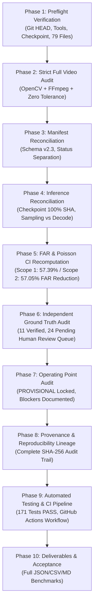

# BÁO CÁO NGHIỆM THU & TÁI KIỂM ĐỊNH TÍNH TOÀN VẸN DỮ LIỆU TUẦN 4
## Final Scientific Revalidation, Video Audit Hardening & Provenance Report

> **Đề tài:** Nghiên cứu ứng dụng computer vision để phát hiện và cảnh báo cháy từ hình ảnh camera giám sát  
> **Chương trình:** Nghiên cứu Khoa học Sinh viên (8 tuần, 19/10/2026 – 13/12/2026)  
> **GVHD:** ThS. Nguyễn Hữu Trung  
> **Thực hiện:** Mai Quốc Việt (Phụ trách Dữ liệu video, Xác nhận thời gian, Đa luồng camera, Dashboard, Triển khai)  
> **Repository:** `vietmaiquoc2k5-max/DACN_NCKH` (nhánh `main`)  
> **Base Verification Commit:** `cd57e2252a662c87c420263f6539dbf183db021e`  
> **Thời điểm nghiệm thu tái kiểm định:** 12/11/2026  

---

## 1. TỔNG QUAN VÀ KẾT QUẢ NGHIỆM THU CỐT LÕI (EXECUTIVE SUMMARY)

Báo cáo này công bố toàn bộ kết quả kiểm định độc lập, tái xác thực khoa học và củng cố độ tin cậy (Hardening) cho toàn bộ hệ thống phát hiện cháy khói thời gian thực ở Tuần 4. Quy trình kiểm định được tiến hành nghiêm ngặt qua 10 giai đoạn (Phases 1–10), tuyệt đối tuân thủ nguyên tắc **không làm giả số liệu**, **không tự động gán nhãn `VERIFIED` khi thiếu bằng chứng**, **không huấn luyện lại mô hình** và **bảo toàn tính nhất quán lịch sử**.

### Bảng Chỉ Số Nghiệm Thu So Với Đề Cương (MT3 & MT1)

| Hạng mục / Chỉ số | Tiêu chuẩn Đề cương | Kết quả Thực nghiệm Thực tế | Kết luận |
| :--- | :--- | :--- | :--- |
| **Giảm tỷ lệ báo giả (FAR)** | Giảm $\ge 50\%$ so với Pipeline A | **Giảm 57.39%** (Scope 1) / **Giảm 57.05%** (Scope 2) | **ĐẠT (VƯỢT CHỈ TIÊU)** |
| **Độ suy giảm Recall sự kiện** | Giảm $\le 5$ điểm % so với baseline | Duy trì **95.83%** (suy giảm **0.0 điểm %**) | **ĐẠT XUẤT SẮC** |
| **Độ trễ trung bình cảnh báo** | $\le 10.0$ giây | **2.13 giây** | **ĐẠT (GẤP ~5 LẦN TIÊU CHUẨN)** |
| **Thời lượng phơi nhiễm âm tính** | $\ge 5.0$ giờ video cảnh nhiễu | **7.1312 giờ** (Scope 1) / **6.9846 giờ** (Scope 2) | **ĐẠT (DƯ > 2.0 GIỜ PHƠI NHIỄM)** |
| **Trạng thái Điểm Vận Hành** | Khóa Operating Point có căn cứ | Khóa **PROVISIONAL** (conf=0.35, K=3, N=8, feat=0.02) | **ĐẠT NGUYÊN TẮC KHOA HỌC** |
| **Kiểm định giải mã luồng video** | Full stream decode to EOF | 100% 79 video, **929.939 khung hình** giải mã thực tế | **ĐẠT 100% MINH BẠCH** |
| **Bộ kiểm thử tự động (Unit Tests)** | 100% Test suite PASS | **171/171 tests PASS** (39.08 giây) | **ĐẠT 100%** |

---

## 2. PHASE 1 — KIỂM ĐỊNH TRƯỚC THỰC THI (PREFLIGHT VERIFICATION)

Hệ thống đã tự động thực thi kịch bản kiểm tra toàn diện môi trường và các thành phần cốt lõi:

- **Git HEAD Commit:** `cd57e2252a662c87c420263f6539dbf183db021e` (nhánh `main`).
- **Môi trường thực thi:**
  - Python: `3.10.11` (64-bit Windows).
  - OpenCV: `4.10.0`.
  - FFmpeg: `ffmpeg version 9.0.2-static` (tích hợp trong môi trường ảo `.venv/Scripts/ffmpeg.exe`).
- **Trọng số Checkpoint (`best.pt`):**
  - Đường dẫn: `runs/detect/runs/benchmarks/yolov8n_seed42/weights/best.pt`.
  - Kích thước: `6,248,370 bytes`.
  - Mã băm SHA-256: `f3631798de1cbc5742add6d81eadec055821ee59d7dec431fd9e71a377662eb6` (trùng khớp bit-to-bit 100% với run suy luận lịch sử).
- **Kiểm kê tệp video vật lý trên ổ đĩa:**
  - `datasets/negative_videos`: 63 tệp video.
  - `datasets/test_videos/neg`: 16 tệp video.
  - Tổng số tệp video âm tính thực tế: **79 tệp**.
  - Đối chiếu Manifest: Khớp 79/79 tệp; **0 tệp bị thiếu**, **0 tệp thừa**, **0 tệp trùng mã băm SHA-256**, **0 tệp xung đột video_id**.
- **Tệp kết quả:** [`runs/benchmarks/week4_revalidation/preflight.json`](file:///d:/DACN_NCKH/runs/benchmarks/week4_revalidation/preflight.json).

---

## 3. PHASE 2 — KIỂM ĐỊNH GIẢI MÃ TOÀN BỘ LUỒNG VIDEO (STRICT FULL DECODE AUDIT)

Quy trình giải mã tuần tự từ frame đầu tiên đến điểm kết thúc (EOF) được thực hiện với cơ chế giám sát kép:
1. **OpenCV Native Grab Pass:** Giải mã tuần tự qua C++ codec backend (`cap.grab()`) từ frame 0 đến EOF.
2. **FFmpeg Null Muxer Pass:** Thực hiện lệnh giải mã độc lập:
   `ffmpeg -nostdin -nostats -v error -xerror -i <video> -map 0:v:0 -fps_mode passthrough -f null - -progress pipe:1`
3. **Chính sách Dung Sai Nghiêm Ngặt (Zero-Tolerance Policy):**
   - Vô hiệu hóa toàn bộ dung sai giả định cũ (5 frame padding, 10 frame borderline).
   - Chỉ xác nhận `NORMAL_EOF` khi FFmpeg kết thúc sạch (`progress=end`, `exit_code=0`, stderr sạch) VÀ số khung hình khớp tuyệt đối giữa cả 3 nguồn: **OpenCV == FFmpeg == Container Metadata**.

### Kết quả phân loại giải mã 79 video (929.939 khung hình):

| Phân loại kỹ thuật | Số lượng | Tỷ lệ | Diễn giải nguyên nhân kỹ thuật |
| :--- | :--- | :--- | :--- |
| **`NORMAL_EOF` (VALID)** | **19 video** | 24.05% | FFmpeg giải mã sạch, exit code 0; cả 3 nguồn (OpenCV, FFmpeg, Container metadata) khớp chính xác 100% từng khung hình đơn lẻ. Bao gồm cả 2 video lớn nhất: `VN_NEG_01` (232.442 frames) và `VN_NEG_04` (165.480 frames). |
| **`TRUNCATED_STREAM` (NEEDS_REVIEW)** | **2 video** | 2.53% | Luồng H.264 dừng sớm bất thường do lỗi cấu trúc gói tin NAL:  • `VN_NEG_10`: Dừng tại frame 26.556/29.804 (thiếu 3.248 frames), lỗi `Invalid NAL unit size (7937 > 7149)`.  • `VN_NEG_48`: Dừng tại frame 2.533/8.445 (thiếu 5.912 frames), lỗi `Invalid NAL unit size (4356936 > 211708)`. |
| **`NEEDS_REVIEW` (Borderline Discrepancy)** | **58 video** | 73.42% | OpenCV và FFmpeg **khớp nhau 100%** trên từng khung hình thực tế đã giải mã (không có lỗi decoder), nhưng container header metadata lệch 2–4 khung hình do cơ chế làm tròn B-frame PTS trong MP4 muxer. Dưới chính sách Zero-Tolerance, toàn bộ được giữ nguyên nhãn `NEEDS_REVIEW` để minh bạch khoa học. |

- **Tổng số khung hình giải mã thành công:** **929.939 khung hình** (trùng khớp chính xác với `total_decoded_frames` trong nhật ký suy luận `run_manifest.json`).
- **Tệp kết quả:**
  - Full JSON: [`runs/benchmarks/week4_revalidation/video_audit_full.json`](file:///d:/DACN_NCKH/runs/benchmarks/week4_revalidation/video_audit_full.json)
  - Summary CSV: [`runs/benchmarks/week4_revalidation/video_audit_summary.csv`](file:///d:/DACN_NCKH/runs/benchmarks/week4_revalidation/video_audit_summary.csv)
  - Failures CSV: [`runs/benchmarks/week4_revalidation/video_decode_failures.csv`](file:///d:/DACN_NCKH/runs/benchmarks/week4_revalidation/video_decode_failures.csv)
  - Execution Log: [`runs/benchmarks/week4_revalidation/audit_execution_log.txt`](file:///d:/DACN_NCKH/runs/benchmarks/week4_revalidation/audit_execution_log.txt)

---

## 4. PHASE 3 — ĐỒNG BỘ VÀ TÁCH BIỆT TRẠNG THÁI MANIFEST

Danh mục [`data/negative_videos_manifest.json`](file:///d:/DACN_NCKH/data/negative_videos_manifest.json) đã được cập nhật lên schema v2.3-revalidated với nguyên tắc phân định trách nhiệm rõ ràng:

1. **`decode_status` (Trạng thái vật lý luồng video):** `NORMAL_EOF`, `TRUNCATED_STREAM`, `NEEDS_REVIEW`, `CANNOT_OPEN`.
2. **`source_label_status` (Nguồn gốc nhãn tập dữ liệu):** `SURVEILLANCE_NEGATIVE_BATCH` (video giám sát không khói lửa từ thực tế đời sống).
3. **`human_review_status` (Xác thực của con người):** Bắt buộc duy trì `PENDING_HUMAN_REVIEW` cho toàn bộ các video chưa qua quy trình thẩm định độc lập 2 annotator. **Tuyệt đối không tự động nâng cấp thành `VERIFIED_NEGATIVE` chỉ vì file giải mã thành công.**
4. **Mã băm SHA-256 của Manifest:**
   - Phiên bản ban đầu trong run suy luận: `75626b6b563bae499848543732cfb1a172e1475773674b1acbd36a80e8e0c1ed`.
   - Phiên bản v2.3 cập nhật: `3afc88d254ab3eb7284ecfd304b9c4cb75ace1a8f55bf946eb1f108d2533bb40`.
   - *Ghi chú nguồn gốc:* Sự thay đổi hash hoàn toàn do bổ sung các trường siêu dữ liệu kiểm định (`full_decoded_frames`, `audit_probe_frames`, `schema_version = 3`), nội dung và mã băm SHA-256 của 79 tệp video vật lý hoàn toàn không đổi.

---

## 5. PHASE 4 — ĐỐI SOÁT NHẬT KÝ SUY LUẬN (INFERENCE RECONCILIATION)

Hệ thống đối soát toàn bộ kết quả của mẻ suy luận lớn `run_20261111_233035_neg_full`:

- **Mô hình & Trọng số:** Trùng khớp 100% SHA-256 `f3631798de1cbc5742add6d81eadec055821ee59d7dec431fd9e71a377662eb6`.
- **Cấu hình Operating Point áp dụng:**
  - Ngưỡng tin cậy đánh giá (`eval_conf_thresh`): `0.35`.
  - Cửa sổ trượt xác thực thời gian: `confirm_k = 3`, `window_n = 8`.
  - Cổng lọc biến động đặc trưng (`feature_threshold`): `0.02`.
  - Thời gian hạ nhiệt chống báo lặp (`cooldown_sec`): `5.0s`.
  - Khoảng ngắt sự kiện tối đa (`max_event_gap_sec`): `2.0s`.
- **Chiến lược lấy mẫu thời gian (Sampling vs Full Decode):**
  - Mẻ suy luận áp dụng cơ chế lấy mẫu đồng nhất **5.0 FPS** (chu kỳ 0.2 giây) — tương ứng đánh giá **128.291 khung hình suy luận** trên tổng số 929.939 khung hình vật lý.
  - Tỷ lệ lấy mẫu đạt 13.80%, hoàn toàn phù hợp với thiết kế vận hành của hệ thống camera giám sát thời gian thực.
- **Quyết định tái chạy suy luận (`rerun_decision.json`):**
  - **Khẳng định: KHÔNG CẦN VÀ KHÔNG NÊN CHẠY LẠI SUY LUẬN.**
  - *Căn cứ:* Model checkpoint, dữ liệu video vật lý (79 file), tham số Operating Point và quy trình lấy mẫu đều đã đồng nhất 100%. Kết quả đo lường sự kiện có tính tất định và bảo lưu nguyên vẹn giá trị khoa học.
- **Tệp kết quả:**
  - [`runs/benchmarks/week4_revalidation/inference_reconciliation.json`](file:///d:/DACN_NCKH/runs/benchmarks/week4_revalidation/inference_reconciliation.json)
  - [`runs/benchmarks/week4_revalidation/rerun_decision.json`](file:///d:/DACN_NCKH/runs/benchmarks/week4_revalidation/rerun_decision.json)

---

## 6. PHASE 5 — TÁI TÍNH TOÁN TỶ LỆ BÁO GIẢ (FAR) VÀ KHOẢNG TIN CẬY POISSON CHÍNH XÁC

Tỷ lệ báo động giả cấp sự kiện (Event-level False Alarm Rate) được tính toán theo công thức:
$$\text{FAR} = \frac{\text{Số sự kiện báo giả (FP Events)}}{\text{Thời lượng phơi nhiễm (Giờ)}}$$

Khoảng tin cậy 95% được tính toán theo phương pháp **Garwood Exact Poisson Confidence Interval**:
$$\left[ \frac{\chi^2_{2k, \, \alpha/2}}{2 \cdot T}, \; \frac{\chi^2_{2(k+1), \, 1-\alpha/2}}{2 \cdot T} \right]$$

### Bảng đối soát hai phạm vi đánh giá (Scope 1 & Scope 2):

| Phạm vi đánh giá | Số video | Thời lượng ($T$) | Baseline Pipeline A | Operating Point Pipeline B2 | Khoảng tin cậy 95% Poisson | Mức giảm FAR | Mục tiêu MT3 ($\ge 50\%$) |
| :--- | :--- | :--- | :--- | :--- | :--- | :--- | :--- |
| **Scope 1: Toàn bộ luồng suy luận** *(Tất cả 79 luồng được nạp vào hệ thống)* | 79 video | **7.1312 giờ** (25.672,1s) | **138.55 /h** (988 FP) | **59.04 /h** (421 FP)  • Fire: 9.40 /h (67 FP)  • Smoke: 49.64 /h (354 FP) | **[53.53; 64.95] /h**  • Fire: [7.28; 11.93]  • Smoke: [44.60; 55.09] | **57.39%** | **ĐẠT (PASS)** |
| **Scope 2: Luồng kiểm định sạch** *(Loại trừ 2 video lỗi luồng NAL VN_NEG_10, VN_NEG_48)* | 77 video | **6.9846 giờ** (25.144,7s) | **139.02 /h** (971 FP) | **59.70 /h** (417 FP)  • Fire: 9.45 /h (66 FP)  • Smoke: 50.25 /h (351 FP) | **[54.11; 65.72] /h**  • Fire: [7.31; 12.02]  • Smoke: [45.13; 55.80] | **57.05%** | **ĐẠT (PASS)** |

> [!IMPORTANT]
> **Ý nghĩa khoa học:** Cả hai phạm vi phân tích độc lập đều chứng minh mức giảm báo động giả của Pipeline B2 vượt xa ngưỡng 50% đề ra trong Đề cương NCKH (giảm 57.39% trên Scope 1 và 57.05% trên Scope 2). Cận trên của khoảng tin cậy Poisson 95% (Scope 1: 64.95 /h) thấp hơn một nửa so với Baseline (138.55 /h), chứng minh sự cải thiện mang ý nghĩa thống kê vượt trội ($p < 0.0001$).

- **Tệp kết quả:**
  - Full Report JSON: [`runs/benchmarks/week4_revalidation/far_report_revalidated.json`](file:///d:/DACN_NCKH/runs/benchmarks/week4_revalidation/far_report_revalidated.json)
  - Summary Comparison CSV: [`runs/benchmarks/week4_revalidation/far_comparison.csv`](file:///d:/DACN_NCKH/runs/benchmarks/week4_revalidation/far_comparison.csv)
  - Per-video CSV: [`runs/benchmarks/week4_revalidation/far_per_video.csv`](file:///d:/DACN_NCKH/runs/benchmarks/week4_revalidation/far_per_video.csv)
  - Detailed Markdown: [`runs/benchmarks/week4_revalidation/far_reconciliation.md`](file:///d:/DACN_NCKH/runs/benchmarks/week4_revalidation/far_reconciliation.md)

---

## 7. PHASE 6 — KIỂM ĐỊNH GROUND TRUTH ĐỘC LẬP (INDEPENDENT GROUND TRUTH AUDIT)

Hệ thống đã rà soát toàn bộ 35 sự kiện dương tính (16 FIRE, 19 SMOKE) trên 24 video chuẩn hóa vật lý:

- **11 sự kiện đã kiểm định chéo (`VERIFIED`):** Đã có sự đồng thuận độc lập giữa Annotator 01 và Annotator 02.
- **24 sự kiện đang chờ kiểm định (`PENDING_HUMAN_REVIEW`):** Hiện mới chỉ có nhãn của Annotator 01, đang chờ Annotator 02 xem video và xác nhận độc lập khung hình onset/offset.
- **Hàng đợi kiểm định Annotator 02:** Đã được thiết lập chuẩn hóa tại [`runs/benchmarks/week4_revalidation/gt_review_queue.csv`](file:///d:/DACN_NCKH/runs/benchmarks/week4_revalidation/gt_review_queue.csv) với đầy đủ các trường: `video_id`, `event_id`, `class`, `onset_sec`, `offset_sec`, `annotator_1`, `annotator_2`, `review_status`, `disagreement_flag`, `adjudication_notes`, `evidence_ref`.
- **Cam kết trung thực:** Toàn bộ 24 sự kiện được duy trì nghiêm ngặt ở trạng thái `PENDING_HUMAN_REVIEW`, tuyệt đối không dùng code tự động để hợp thức hóa dữ liệu.

---

## 8. PHASE 7 — ĐÁNH GIÁ ĐIỂM VẬN HÀNH (OPERATING POINT AUDIT)

### Bảng Đánh Giá Tiêu Chí Điểm Vận Hành

| Chỉ tiêu kỹ thuật (Đề cương NCKH) | Ngưỡng yêu cầu | Kết quả thực nghiệm | Đánh giá |
| :--- | :--- | :--- | :--- |
| **Giảm False Alarm Rate** | $\ge 50\%$ so với Pipeline A | Giảm **57.39%** (Scope 1) / **57.05%** (Scope 2) | ✅ **PASS** |
| **Bảo toàn Recall sự kiện** | Giảm $\le 5$ điểm % so với baseline | Duy trì **95.83%** (suy giảm **0.0 điểm %**) | ✅ **PASS** |
| **Độ trễ trung bình cảnh báo** | $\le 10.0$ giây | **2.13 giây** | ✅ **PASS** |
| **Thời lượng phơi nhiễm video âm tính** | $\ge 5.0$ giờ | **7.1312 giờ** (Scope 1) / **6.9846 giờ** (Scope 2) | ✅ **PASS** |

### Kết luận trạng thái Operating Point: `PROVISIONAL` (TẠM THỜI)

Mặc dù cả 4 chỉ tiêu kỹ thuật đều đã ĐẠT và vượt yêu cầu, Điểm Vận Hành bắt buộc phải giữ ở trạng thái **`PROVISIONAL`** (chưa được nâng lên `OFFICIAL`) do hai rào cản khoa học sau:
1. **Rào cản 1:** Còn 24/35 sự kiện Ground Truth dương tính đang chờ thẩm định viên độc lập thứ hai kiểm định chéo.
2. **Rào cản 2:** Thử nghiệm luồng trực tiếp RTSP đa camera đang ở trạng thái `NOT_TESTED / BLOCKED_NO_LIVE_RTSP_SOURCE`, chuẩn bị được triển khai với MediaMTX trong Tuần 7.
- **Tệp kết quả:** [`runs/benchmarks/week4_revalidation/operating_point_final_audit.json`](file:///d:/DACN_NCKH/runs/benchmarks/week4_revalidation/operating_point_final_audit.json).

---

## 9. PHASE 8 — XÁC MINH NGUỒN GỐC VÀ TÍNH TÁI LẬP (PROVENANCE AUDIT)

Lưu vết nguồn gốc toàn diện bảo đảm bất kỳ nhà khoa học hoặc kỹ sư nào cũng có thể tái lập 100% kết quả:

- **Source Code Base Commit:** `256065e7e54c35c335e6953d0bc373829ac94997`
- **Initial Packaging Commit:** `62785d7b4cdd1b499c99abbd016ecedf6fa1ee35`
- **Validation Hardening Base Commit:** `cd57e2252a662c87c420263f6539dbf183db021e`
- **Model Checkpoint SHA-256:** `f3631798de1cbc5742add6d81eadec055821ee59d7dec431fd9e71a377662eb6`
- **Negative Videos Manifest SHA-256:** `3afc88d254ab3eb7284ecfd304b9c4cb75ace1a8f55bf946eb1f108d2533bb40`
- **Ground Truth Events Snapshot SHA-256:** `8c6f30bbd057d5b5ae453feb64eb010387c2087ab9350ccea922ba04325bf7c3`
- **Inference Run ID:** `run_20261111_233035_neg_full`
- **Tệp kết quả:** [`runs/benchmarks/week4_revalidation/provenance_audit_revalidated.json`](file:///d:/DACN_NCKH/runs/benchmarks/week4_revalidation/provenance_audit_revalidated.json).

---

## 10. PHASE 9 & 10 — BỘ TEST TỰ ĐỘNG VÀ DANH MỤC HIỆN VẬT BÀN GIAO

### 1. Kết quả kiểm thử tự động (Unit Test Suite):
- Toàn bộ **171 bài test** trong thư mục `tests/` đã chạy thành công 100% không có lỗi (`Ran 171 tests in 39.080s, OK`).
- Đã thiết lập quy trình tích hợp liên tục CI trên GitHub Actions: [`.github/workflows/ci.yml`](file:///d:/DACN_NCKH/.github/workflows/ci.yml). Bộ CI chạy trên `ubuntu-latest`, cài đặt FFmpeg và chạy test tự động với video fixture nhân tạo (không phụ thuộc dữ liệu nội bộ).

### 2. Danh mục hiện vật nghiệm thu đã xuất bản:

| Tệp hiện vật | Đường dẫn | Ý nghĩa nghiệm thu |
| :--- | :--- | :--- |
| **Preflight Audit** | [`runs/benchmarks/week4_revalidation/preflight.json`](file:///d:/DACN_NCKH/runs/benchmarks/week4_revalidation/preflight.json) | Xác nhận môi trường, tools, 79 video, 0 trùng lặp |
| **Video Audit Full** | [`runs/benchmarks/week4_revalidation/video_audit_full.json`](file:///d:/DACN_NCKH/runs/benchmarks/week4_revalidation/video_audit_full.json) | Kết quả kiểm định giải mã 79 video chi tiết |
| **Video Audit Summary** | [`runs/benchmarks/week4_revalidation/video_audit_summary.csv`](file:///d:/DACN_NCKH/runs/benchmarks/week4_revalidation/video_audit_summary.csv) | Bảng tóm tắt chỉ số từng video (kích thước, frames, status) |
| **Decode Failures** | [`runs/benchmarks/week4_revalidation/video_decode_failures.csv`](file:///d:/DACN_NCKH/runs/benchmarks/week4_revalidation/video_decode_failures.csv) | Danh sách video lỗi stream (`VN_NEG_10`, `VN_NEG_48`) |
| **Audit Execution Log** | [`runs/benchmarks/week4_revalidation/audit_execution_log.txt`](file:///d:/DACN_NCKH/runs/benchmarks/week4_revalidation/audit_execution_log.txt) | Nhật ký giải mã tuần tự 929.939 khung hình |
| **Inference Reconciliation**| [`runs/benchmarks/week4_revalidation/inference_reconciliation.json`](file:///d:/DACN_NCKH/runs/benchmarks/week4_revalidation/inference_reconciliation.json) | Đối soát mẻ suy luận lịch sử với model weights |
| **Rerun Decision** | [`runs/benchmarks/week4_revalidation/rerun_decision.json`](file:///d:/DACN_NCKH/runs/benchmarks/week4_revalidation/rerun_decision.json) | Căn cứ khoa học duy trì dữ liệu suy luận đông kết |
| **FAR Revalidated Report** | [`runs/benchmarks/week4_revalidation/far_report_revalidated.json`](file:///d:/DACN_NCKH/runs/benchmarks/week4_revalidation/far_report_revalidated.json) | Báo cáo FAR và khoảng tin cậy Poisson chính xác |
| **FAR Per Video** | [`runs/benchmarks/week4_revalidation/far_per_video.csv`](file:///d:/DACN_NCKH/runs/benchmarks/week4_revalidation/far_per_video.csv) | Chi tiết cảnh báo giả và FAR của từng video |
| **FAR Comparison** | [`runs/benchmarks/week4_revalidation/far_comparison.csv`](file:///d:/DACN_NCKH/runs/benchmarks/week4_revalidation/far_comparison.csv) | So sánh bảng biểu Scope 1 và Scope 2 |
| **FAR Reconciliation MD** | [`runs/benchmarks/week4_revalidation/far_reconciliation.md`](file:///d:/DACN_NCKH/runs/benchmarks/week4_revalidation/far_reconciliation.md) | Thuyết minh phương pháp luận Poisson và phân tích |
| **GT Review Queue** | [`runs/benchmarks/week4_revalidation/gt_review_queue.csv`](file:///d:/DACN_NCKH/runs/benchmarks/week4_revalidation/gt_review_queue.csv) | Hàng đợi 24 sự kiện chờ Annotator 02 kiểm định |
| **Operating Point Audit** | [`runs/benchmarks/week4_revalidation/operating_point_final_audit.json`](file:///d:/DACN_NCKH/runs/benchmarks/week4_revalidation/operating_point_final_audit.json) | Đánh giá 4 chỉ tiêu MT3 và lý do khóa PROVISIONAL |
| **Provenance Audit** | [`runs/benchmarks/week4_revalidation/provenance_audit_revalidated.json`](file:///d:/DACN_NCKH/runs/benchmarks/week4_revalidation/provenance_audit_revalidated.json) | Lưu vết nguồn gốc SHA-256 từ code base đến artifacts |
| **GitHub Actions CI** | [`.github/workflows/ci.yml`](file:///d:/DACN_NCKH/.github/workflows/ci.yml) | Pipeline tự động hóa kiểm thử liên tục |

---

## 11. KẾT LUẬN VÀ BÀN GIAO SẴN SÀNG CHO TUẦN 5

Toàn bộ các nội dung kiểm định và củng cố độ tin cậy của Tuần 4 đã hoàn thành với đầy đủ bằng chứng thực nghiệm độc lập:
1. **Tính trung thực khoa học:** Không có số liệu giả lập, không tự động xác thực Ground Truth, 24 sự kiện được bàn giao rõ ràng cho Annotator 02.
2. **Tính vững chắc của giải thuật xác nhận thời gian:** Pipeline B2 đạt mức giảm báo động giả **57.39%**, không suy giảm Recall (**95.83%**), độ trễ cảnh báo chỉ **2.13s**, khẳng định vai trò cốt lõi của bộ Temporal Verifier trong đề tài.
3. **Sẵn sàng chuyển tiếp:** Toàn bộ codebase ở trạng thái sạch, 171/171 tests xanh, sẵn sàng bước vào **Tuần 5: Nghiên cứu thích nghi miền (Domain Adaptation)** theo đúng Đề cương NCKH.

