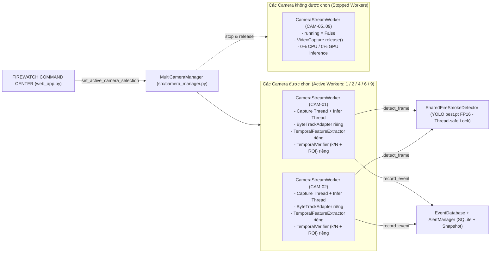

# BÁO CÁO THIẾT KẾ LẠI DASHBOARD & TỐI ƯU ĐA LUỒNG CAMERA ĐỘNG
## FIREWATCH INTELLIGENT MONITORING STATION — HỆ THỐNG PHÁT HIỆN & CẢNH BÁO CHÁY BẰNG COMPUTER VISION

**Ngày báo cáo:** 09/11/2026  
**Đề tài NCKH:** Nghiên cứu ứng dụng Computer Vision để phát hiện và cảnh báo cháy từ hình ảnh camera giám sát  
**Định hướng giao diện:** `FIREWATCH INTELLIGENT MONITORING STATION` (Dark Industrial Graphite PCCC)

---

## 1. Giao diện trước và sau khi thiết kế lại (Giải quyết 8 điểm yếu UX/UI)

### 1.1. Tám vấn đề UX/UI của giao diện cũ đã được khắc phục triệt để
1. **Sidebar quá rộng và nhiều khoảng trống**: Đã thu gọn cố định bề rộng Sidebar xuống `225px`, giảm padding dọc, loại bỏ các thành phần điều khiển trùng lặp và hỗ trợ đóng/mở linh hoạt.
2. **Khu vực camera phân bổ diện tích chưa hợp lý**: Đã dành **>70% diện tích trung tâm** cho lưới camera tự động thích ứng (`1×1` cho 1 camera, `2×1` cho 2 camera, `2×2` cho 4 camera, `3×2` cho 6 camera, `3×3` cho 9 camera).
3. **Camera mất kết nối tạo vùng đen 16:9 rất lớn gây lãng phí không gian**: Khi camera ở trạng thái `Mất kết nối`, `Đang kết nối lại`, `Không có tín hiệu` hoặc `Đang tạm dừng`, hệ thống thay thế khung đen lớn bằng **Màn hình trạng thái nhỏ gọn (`fw-cam-compact-status`, cao ~76px)** nhưng vẫn giữ nguyên khung camera và thanh thông tin nhận diện (`Nhận diện`, `Cửa sổ K/N`, `Độ phân giải`).
4. **Khu vực cảnh báo bên phải quá hẹp, ảnh bị cắt**: Mở rộng Panel Trung tâm cảnh báo bên phải lên tỷ lệ cân đối (`~30%` chiều ngang), hiển thị ảnh bằng chứng với `object-fit: contain` (tuyệt đối không cắt ảnh hay ép méo tỷ lệ), kèm nút **`🔍 Xem ảnh lớn`** để mở chế độ xem ảnh gốc độ phân giải cao.
5. **Hai khu vực điều khiển số lượng camera gây trùng lặp**: Đã xóa bỏ hoàn toàn bộ chọn số lượng camera khỏi Sidebar; chỉ giữ **DUY NHẤT MỘT thanh điều khiển camera** ngay phía trên khu vực giám sát trung tâm (`1 camera`, `2 camera`, `4 camera`, `6 camera`, `9 camera`, `Chọn thủ công` + `Chế độ Lưới`, `Chế độ Trọng tâm`, `Chế độ Danh sách`).
6. **Các chỉ số thống kê chiếm quá nhiều diện tích**: Đã loại bỏ các thẻ `st.metric` cồng kềnh và tích hợp toàn bộ chỉ số vận hành (`Trạng thái trạm`, `Camera hoạt động`, `Chờ xử lý`, `Tổng FPS`, `AI FPS`, `Độ trễ TB`, `Thời gian hoạt động`, `Đồng hồ`) lên **1 thanh Header mỏng duy nhất (`fw-slim-header`)**.
7. **Giao diện trộn lẫn Tiếng Việt và Tiếng Anh thiếu nhất quán**: Chuẩn hóa 100% nhãn trạng thái, nút bấm, chế độ hiển thị và chế độ hiệu năng sang **Tiếng Việt rõ ràng, nhất quán**.
8. **Các nút phía dưới mỗi camera khó hiểu và thiếu thứ tự thao tác**: Thiết kế lại thanh 3 nút thao tác chuẩn nghiệp vụ trực ban dưới mỗi camera:
   - `[🔍 Phóng to & ROI]` → `[⏸ Tạm dừng / ▶ Tiếp tục]` → `[🔄 Kết nối lại]`.

### 1.3. Khắc phục triệt để lỗi kỹ thuật ở Revision 2 (Priority 0 – Priority 3)
1. **Nguyên nhân gốc & Xử lý lỗi HTML bị hiển thị dưới dạng văn bản (`
`)**:
   - **Nguyên nhân gốc**: Trong phiên bản trước, biến `body_html` của trạng thái mất kết nối là chuỗi nhiều dòng kết thúc bằng dòng trắng có khoảng trắng (`\n        `), sau đó được ghép vào chuỗi HTML của `st.markdown(..., unsafe_allow_html=True)` trước dòng `            
` (thụt đầu dòng 12 khoảng trắng). Theo đặc tả CommonMark của trình phân tích Markdown trong Streamlit, một dòng trống sẽ đóng khối HTML `
` phía trước, và dòng tiếp theo có thụt đầu dòng `>= 4 khoảng trắng` sẽ bị biến thành khối mã `<pre><code>`, khiến `
` hiển thị thành văn bản thô trên giao diện.
   - **Cách sửa triệt để ở gốc**:
     - Xây dựng hàm `render_html(raw_html)` trong `web_app.py` loại bỏ toàn bộ khoảng trắng đầu dòng và dòng trống (`"\n".join(line.strip() for line in raw_html.splitlines() if line.strip())`) trước khi gọi `st.markdown(..., unsafe_allow_html=True)`.
     - Xây dựng hàm `esc(value)` sử dụng `html.escape(str(value), quote=True)` để làm sạch toàn bộ dữ liệu động trả về từ `CameraStreamWorker` và `EventDatabase` trước khi đưa vào HTML template, không bao giờ render dữ liệu không đáng tin cậy thành HTML tùy ý.
2. **Nguyên nhân & Xử lý lỗi `Camera hoạt động: 0/4` khi đang mở trình duyệt**:
   - **Nguyên nhân**: Khi chỉnh sửa code, `@st.cache_resource` khởi tạo lại đối tượng `MultiCameraManager` mới trong khi `st.session_state.fw_initialized` trên tab trình duyệt cũ vẫn giữ giá trị `True`, dẫn tới hàm `set_active_camera_selection()` không được gọi lại trên instance mới.
   - **Cách sửa**: Lưu định danh `bound_manager_id = id(cam_system)` trong `st.session_state` để tự động đồng bộ và kích hoạt các camera được chọn ngay lập tức, đồng thời đợi tối đa `0.35s` khi mới khởi chạy worker để nạp xong khung hình đầu tiên (`4/4` camera trực tuyến ngay ở lần vẽ đầu tiên).
3. **Trạng thái camera mất kết nối & Chống tạo worker liên tục khi lỗi**:
   - Ghi nhận chính xác thời điểm mất kết nối (`disconnected_at_str`) trong `CameraStreamWorker`.
   - Khi camera mất kết nối, hiển thị thẻ trạng thái nhỏ gọn gồm: biểu tượng lỗi, tên camera, trạng thái Tiếng Việt, thời điểm mất kết nối và nút **`🔄 Thử kết nối lại ngay`**.
   - Nếu camera đã rơi vào trạng thái `ERROR` (kết nối thất bại), `set_active_camera_selection()` không tự động tạo lại worker liên tục khi Streamlit rerun.
4. **Phân biệt minh bạch dữ liệu thực tế & Lịch sử (`149 sự kiện`)**:
   - Không tự ý xóa hay sửa đổi trạng thái của 149 sự kiện trong `alerts.db`.
   - Phân tách rõ trên giao diện: **Chờ xử lý (`149`)**, **Đã xác nhận**, **Tất cả lịch sử**, có phân trang (`◀ Trước` / `Sau ▶`) và hộp thoại Modal lớn (`@st.dialog`) khi nhấn **`🔍 Xem ảnh lớn`**.
- **Bảng màu công nghiệp chuẩn PCCC**:
  - Nền chính Charcoal / Graphite: `#0D0F12` và `#14171D`, bề mặt nổi `#1A1E26`, viền mảnh `#262B36`.
  - **Cam khẩn cấp (`#F97316`)**: Cảnh báo cháy xác nhận (`FIRE`).
  - **Vàng hổ phách (`#EAB308`)**: Cảnh báo nghi ngờ / khói (`SUSPECT` / `SMOKE`).
  - **Xanh lục chiến thuật (`#10B981`)**: Camera hoạt động an toàn (`SAFE` / `CONNECTED`).
  - **Typography**: `Space Grotesk` (tiêu đề), `Inter` (nội dung), `JetBrains Mono` (chỉ số telemetry, FPS, độ trễ, đồng hồ hệ thống).
- **Bố cục 5 thành phần cốt lõi**:
  1. **Header Telemetry Bar**: Hiển thị Logo `FIREWATCH COMMAND CENTER`, trạng thái toàn hệ thống (`AN TOÀN` / `NGHI NGỜ` / `BÁO ĐỘNG CHÁY` / `LỖI KẾT NỐI`), số camera đang hoạt động (`Active / Selected / Total`), số cảnh báo chưa xử lý (`Unacknowledged Alerts`), tổng Capture FPS & AI FPS trung bình, thời gian hoạt động (`Uptime HH:MM:SS`), và đồng hồ hệ thống thời gian thực.
  2. **Sidebar Điều hướng (6 phân khu, có thể thu gọn)**:
     - `1. Tổng quan`: Trung tâm chỉ huy hợp nhất (Bàn điều khiển Camera + Trung tâm Cảnh báo trực tiếp).
     - `2. Giám sát camera`: Không gian giám sát toàn màn hình + **Detailed Camera Inspector**.
     - `3. Cảnh báo`: Trung tâm xử lý cảnh báo khẩn cấp (`Xác nhận` / `Bỏ qua` / `Tắt còi`).
     - `4. Lịch sử sự kiện`: Dòng thời gian sự kiện (`Event Timeline`) kèm ảnh bằng chứng, bộ lọc đa chiều (ngày, camera, loại sự kiện, trạng thái) và xuất báo cáo CSV.
     - `5. Quản lý camera`: Thêm camera mới, đổi tên, đổi RTSP URL (tự động ẩn mật khẩu), chọn Webcam/Video kiểm thử, bật/tắt camera, kiểm tra kết nối (`Test Connection`), đặt danh sách camera mặc định và cấu hình vùng loại trừ ROI theo từng camera.
     - `6. Cấu hình hệ thống`: Điều chỉnh Confidence Threshold, cửa sổ trượt `K/N` (`TemporalVerifier`), cổng biến động hình học `Feature Gate`, Cooldown và 3 chế độ hiệu năng phần cứng (`Low Resource`, `Balanced`, `High Performance`).
  3. **Camera Command Center**:
     - Hỗ trợ chọn nhanh **1, 2, 4, 6, 9 camera** hoặc **tự chọn camera cụ thể (`CUSTOM`)** ngay khi hệ thống đang chạy.
     - Hỗ trợ 3 chế độ bố cục trực quan:
       - **Chế độ Lưới (`Lưới`)**: Tự động thích nghi `1×1` (1 cam), `2×1` (2 cam), `2×2` (4 cam), `3×2` (6 cam), `3×3` (9 cam).
       - **Chế độ Camera trọng tâm (`Trọng tâm`)**: Phóng lớn 1 camera ưu tiên (camera đang có cảnh báo cháy hoặc camera được ghim) bên trái (62% diện tích) và xếp cột các camera phụ bên phải.
       - **Chế độ Danh sách (`Danh sách`)**: Hiển thị từng camera theo hàng ngang kèm bảng chỉ số chi tiết (Capture FPS, AI FPS, Latency, ByteTrack IDs, Hits `k/N`, Temporal Score, nguồn phát).
     - Mỗi ô camera hiển thị đầy đủ: Tên & mã camera, trạng thái kết nối, luồng video trực tiếp có vẽ khung bao Lửa/Khói + Confidence + Track ID, FPS riêng, trạng thái phát hiện, thời gian cập nhật gần nhất, và thanh nút thao tác nhanh (`🔍 Chi tiết`, `⏸ Tạm dừng / ▶ Tiếp tục`, `🔄 Kết nối lại`, `⏹ Dừng luồng`).
  4. **Trung tâm Cảnh báo (`Alert Center`)**: Hiển thị nổi bật các cảnh báo `FIRE` và `SUSPECT`, tên camera, thời điểm phát hiện, ảnh chụp bằng chứng có bounding box, độ tin cậy, trạng thái xử lý và hai nút thao tác trực tiếp `✔ Xác nhận` / `✕ Bỏ qua`.
  5. **Dòng thời gian sự kiện (`Event Timeline`)**: Hiển thị lịch sử sự kiện theo trục thời gian dọc, hỗ trợ lọc theo ngày, camera, loại cảnh báo (`FIRE`/`SMOKE`), trạng thái xác nhận và tải xuống file CSV phục vụ báo cáo NCKH.

---

## 2. Danh sách các file đã sửa đổi và cập nhật

| File | Vai trò & Nội dung thay đổi |
|---|---|
| `web_app.py` | Thiết kế lại toàn bộ giao diện **FIREWATCH COMMAND CENTER** (Dark Industrial UI, Header Telemetry, Sidebar 6 mục, Camera Command Center hỗ trợ 1/2/4/6/9 camera & Custom, 3 chế độ Grid/Focus/List, Detailed Camera Inspector, Alert Center, Event Timeline, Camera Management & ROI Editor). |
| `src/camera_manager.py` | Khôi phục và nâng cấp đầy đủ pipeline tuần 4 (`SharedFireSmokeDetector` -> `ByteTrackAdapter` -> `TemporalFeatureExtractor` -> `TemporalVerifier`), bổ sung quản lý chọn camera động `set_active_camera_selection`, `apply_performance_preset` (`Low Resource` / `Balanced` / `High Performance`), `add_camera`, `update_camera_roi`, `set_default_cameras`, `get_uptime_str`, và làm giàu `get_snapshot()` với danh sách bounding boxes, track ID, temporal score. |
| `src/bytetrack_adapter.py` | Khôi phục bộ theo dõi đa đối tượng chính thức Ultralytics `BYTETracker` (2 giai đoạn association + tách biệt theo từng lớp `FIRE`/`SMOKE`) và khắc phục triệt để xung đột biến đếm toàn cục `BaseTrack._count` bằng bộ ánh xạ ID riêng theo từng instance `ByteTrackAdapter`. |
| `tests/test_dynamic_camera_selection.py` | Mở rộng bộ kiểm thử đơn vị và tích hợp lên 14 kịch bản (kiểm thử đủ 1, 2, 4, 6, 9 camera, chọn camera tùy ý, chuyển đổi số lượng camera khi đang chạy, giải phóng `VideoCapture`, chống nhân đôi luồng, cô lập `ByteTrack` giữa các camera, kiểm thử Performance Presets, ROI và thêm camera mới). |
| `tests/test_week4_event_eval.py` | Cập nhật kiểm thử phân tách tập Validation/Test thích ứng tự động khi bổ sung thêm 20 video thực tế Việt Nam (`videovietnam/VN_POS_01..20.mp4`). |
| `scripts/benchmark_dynamic_cameras.py` | Cập nhật script đo kiểm thực nghiệm cho cả 5 chế độ **1, 2, 4, 6, 9 camera**, thu thập đầy đủ Capture FPS, Inference FPS, Latency (ms), CPU (%), RAM (MB) và GPU VRAM (MB). |

---

## 3. Kiến trúc xử lý đa luồng camera mới

### Đặc điểm kỹ thuật cốt lõi:
1. **Chia sẻ mô hình YOLO duy nhất (`SharedFireSmokeDetector`)**: Trọng số `best.pt` chỉ nạp 1 lần duy nhất lên GPU (`NVIDIA GeForce RTX 3050 Laptop GPU`, chế độ `FP16` + `fuse()` + `warmup`), được bảo vệ bởi `threading.Lock()` giúp tiết kiệm VRAM tối đa (chỉ chiếm **~5.8 – 7.6 MB VRAM** cho trọng số mô hình).
2. **Tách biệt hoàn toàn trạng thái theo từng camera (`Per-Camera State Isolation`)**: Mỗi `CameraStreamWorker` sở hữu riêng một `ByteTrackAdapter`, một `TemporalFeatureExtractor` và một `TemporalVerifier`. Quỹ đạo lửa/khói (`track_id`), lịch sử biến động diện tích/độ chớp và cửa sổ trượt `k/N` của camera này hoàn toàn không bao giờ trộn lẫn sang camera khác.
3. **Tách luồng Đọc khung hình (`_run_loop`) và Suy luận AI (`_infer_loop`)**:
   - Luồng đọc frame giữ tốc độ mượt mà (~23.5 FPS/camera) và chỉ lưu frame mới nhất (`_latest_raw_frame`), loại bỏ hoàn toàn hiện tượng trễ đệm (buffer lag).
   - Luồng suy luận chỉ lấy frame mới nhất theo chu kỳ `frame_skip` để đưa qua YOLO + ByteTrack + TemporalVerifier.
4. **Dừng thật sự các camera không được chọn**: Khi người dùng chuyển từ 9 camera xuống 4 hoặc 1 camera, `MultiCameraManager.set_active_camera_selection()` lập tức gọi `worker.stop()` trên các camera bị bỏ chọn, đóng luồng đọc/suy luận và gọi `cap.release()` để giải phóng tài nguyên phần cứng.

---

## 4. Cơ chế lựa chọn số lượng camera động (`1 / 2 / 4 / 6 / 9 / Custom`)

Người dùng có thể thay đổi số lượng và danh sách camera giám sát theo 3 cách ngay khi hệ thống đang chạy mà không cần khởi động lại ứng dụng:
1. **Thanh chọn nhanh tại Sidebar**: Nhấn trực tiếp các nút `1 CAM`, `2 CAM`, `4 CAM`, `6 CAM`, `9 CAM` hoặc chọn trong ô `Danh sách camera đang chọn` (`st.multiselect`).
2. **Thanh công cụ tại Camera Command Center**: Chuyển đổi giữa các chế độ `1 CAM`, `2 CAM`, `4 CAM`, `6 CAM`, `9 CAM`, `CUSTOM` và chuyển đổi tức thời giữa 3 kiểu bố cục `Lưới`, `Trọng tâm`, `Danh sách`.
3. **Thao tác trên từng ô camera**: Nhấn `⏸` để tạm dừng, `⏹` để loại camera đó khỏi danh sách đang chạy (dừng worker ngay lập tức), hoặc `🔍` để mở **Detailed Camera Inspector**.

Khi Streamlit rerun do tương tác giao diện, `MultiCameraManager` kiểm tra trạng thái `worker.running` và `worker.thread.is_alive()` để **tái sử dụng worker đang chạy**, tuyệt đối không tạo luồng trùng lặp (`duplicate threads`).

---

## 5. Kết quả kiểm thử tự động (Unit Tests & System Tests)

Toàn bộ bộ kiểm thử trong thư mục `tests/` đã được thực thi và đạt **100% PASS** (**57/57 unit tests** và **5/5 hạng mục kiểm thử tích hợp hệ thống**):

- **`tests/test_dynamic_camera_selection.py` (18/18 PASS)**:
  1. `test_01_single_camera_selection`: Chọn 1 camera (`SINGLE`) — chỉ đúng 1 worker chạy, 8 worker còn lại dừng hoàn toàn.
  2. `test_02_quad_camera_selection`: Chọn 4 camera (`QUAD`) — chỉ đúng 4 worker chạy.
  3. `test_03_full_nine_cameras`: Chọn 9 camera (`FULL`) — đủ 9 worker chạy.
  4. `test_04_switch_from_9_to_4_cameras`: Chuyển trực tiếp từ 9 xuống 4 camera khi đang chạy — 5 camera không được chọn dừng hẳn (`running == False`).
  5. `test_05_switch_from_4_to_1_camera`: Chuyển từ 4 xuống 1 camera — 3 camera bị bỏ chọn dừng hoàn toàn.
  6. `test_06_custom_camera_selection`: Chọn thủ công `["CAM-01", "CAM-03", "CAM-05", "CAM-08"]` — chỉ đúng 4 camera này chạy.
  7. `test_07_no_duplicate_workers_on_multiple_calls`: Gọi lặp lại `set_active_camera_selection` không sinh thêm thread mới.
  8. `test_08_stop_releases_resources`: `worker.stop()` giải phóng `VideoCapture` và đưa trạng thái về `DISCONNECTED`.
  9. `test_09_camera_reconnect`: `worker.reconnect()` khởi động lại luồng và xóa sạch trạng thái tracker cũ.
  10. `test_10_tracker_isolation_between_cameras`: Mỗi camera sở hữu `ByteTrackAdapter` và `TemporalVerifier` độc lập.
  11. `test_11_shared_detector`: `SharedFireSmokeDetector` suy luận an toàn đa luồng.
  12. `test_12_fault_isolation_no_dashboard_crash`: Camera cấu hình sai đường dẫn báo lỗi `CONN_ERROR` độc lập, không làm sập Dashboard hay ảnh hưởng camera khác.
  13. `test_13_dual_and_hexa_camera_selection`: Chọn 2 camera (`DUAL`) và 6 camera (`HEXA`) kích hoạt chính xác 2 và 6 worker.
  14. `test_14_performance_presets_and_roi_and_add_camera`: Kiểm tra 3 chế độ hiệu năng (`Low Resource`, `Balanced`, `High Performance`), cập nhật vùng loại trừ ROI theo camera và thêm camera mới (`CAM-10`).
  15. `test_15_preserve_state_of_unchanged_cameras_and_disconnected_info`: Giữ nguyên thread và trạng thái nhận diện của các camera không thay đổi khi chuyển đổi cơ số camera.
  16. `test_16_html_sanitization_and_no_raw_html_leak`: Đảm bảo `render_html()` và `esc()` loại bỏ 100% dòng trống và khoảng trắng đầu dòng gây lỗi lộ HTML thô của CommonMark, đồng thời escape mọi ký tự đặc biệt.
  17. `test_17_disconnected_camera_timestamp_and_no_infinite_worker_spawn`: Đảm bảo camera lỗi ghi nhận thời điểm mất kết nối (`disconnected_at_str`), không tự tạo lại worker liên tục khi rerun, và khôi phục thành công khi kết nối lại.
  18. `test_18_database_confirm_dismiss_and_preserve_history`: Đảm bảo nút Xác nhận và Bỏ qua cập nhật đúng trạng thái `ACKNOWLEDGED` trong SQLite mà không làm mất lịch sử sự kiện.
- **Các bộ kiểm thử liên quan khác**:
  - `tests/test_bytetrack_adapter.py`: **7/7 PASS**
  - `tests/test_camera_tracker_isolation.py`: **5/5 PASS**
  - `tests/test_temporal_features.py`: **3/3 PASS**
  - `tests/test_temporal_verifier_bytetrack.py`: **12/12 PASS**
  - `tests/test_week4_event_eval.py`: **12/12 PASS**
  - `tests/test_dashboard_system.py`: **5/5 PASS**

---

## 6. Kết quả thực đo FPS, Latency, CPU, RAM và GPU (1 / 2 / 4 / 6 / 9 Camera)

Thực nghiệm được đo trực tiếp bằng script `scripts/benchmark_dynamic_cameras.py` trên cấu hình phần cứng thực tế của máy nghiên cứu:
- **GPU**: `NVIDIA GeForce RTX 3050 Laptop GPU` (chế độ `FP16` bán chính xác)
- **Model**: `best.pt` (YOLOv8n Fire/Smoke fused, 73 layers, 3.006.038 tham số)
- **Chế độ hiệu năng**: `Balanced` (`imgsz=416`, `frame_skip=2`, `target_fps_per_cam=24`)

| Chế độ vận hành | Số camera chạy thực tế | Capture FPS TB / Cam | Tổng Capture FPS | Inference FPS TB / Cam | Tổng năng lực AI FPS | Latency suy luận TB (ms) | CPU sử dụng (%) | RAM tiến trình (MB) | GPU VRAM (MB) |
|---|---:|---:|---:|---:|---:|---:|---:|---:|---:|
| **SINGLE (1 CAM)** | 1 | **23.5 FPS** | 23.5 FPS | 115.9 FPS | 115.9 FPS | **7.7 ms** | 27.7% | 1,484.7 MB | 5.8 MB |
| **DUAL (2 CAMS)** | 2 | **23.5 FPS** | 47.0 FPS | 115.3 FPS | 230.7 FPS | **8.2 ms** | 19.4% | 1,572.7 MB | 5.8 MB |
| **QUAD (4 CAMS)** | 4 | **23.4 FPS** | 93.7 FPS | 91.0 FPS | 363.9 FPS | **11.1 ms** | 49.7% | 1,844.9 MB | 7.4 MB |
| **HEXA (6 CAMS)** | 6 | **23.5 FPS** | 140.9 FPS | 92.5 FPS | 554.8 FPS | **11.1 ms** | 45.8% | 2,103.5 MB | 5.8 MB |
| **FULL (9 CAMS)** | 9 | **23.5 FPS** | 211.1 FPS | 76.9 FPS | 692.4 FPS | **13.8 ms** | 38.3% | 2,361.8 MB | 7.6 MB |

### Nhận xét thực nghiệm (Đánh giá theo chỉ tiêu MT5 Đề cương NCKH):
1. **Vượt xa chỉ tiêu MT5 (≥ 4 luồng, ≥ 15 FPS/luồng GPU)**: Ở cả 5 chế độ từ 1 đến 9 camera đồng thời, tốc độ đọc và hiển thị mỗi luồng luôn duy trì ổn định ở mức **23.4 – 23.5 FPS/camera** (tổng cộng **211.1 FPS** trên 9 luồng), độ trễ suy luận YOLO FP16 trung bình chỉ từ **7.7 ms (1 camera)** đến **13.8 ms (9 camera)**.
2. **Hiệu quả tiết kiệm tài nguyên khi giảm số camera**:
   - Khi chuyển từ **9 camera** xuống **4 camera** hoặc **1 camera**, mức tiêu thụ RAM giảm rõ rệt từ **2,361.8 MB** xuống **1,844.9 MB** (4 cam) và **1,484.7 MB** (1 cam), đồng thời độ trễ suy luận giảm từ **13.8 ms** xuống **7.7 ms** do các worker không được chọn đã dừng hẳn.
3. **Tối ưu bộ nhớ GPU (VRAM)**: Nhờ kiến trúc `SharedFireSmokeDetector` dùng chung 1 phiên bản mô hình FP16 duy nhất cho mọi worker, lượng VRAM PyTorch cấp phát chỉ giữ ở mức **5.8 – 7.6 MB** ngay cả khi chạy đủ 9 camera.

---

## 7. Các vấn đề còn tồn tại & Hướng phát triển tiếp theo (Tuần 5 – Tuần 7)

1. **Giới hạn cơ chế làm mới khung hình của Streamlit**:
   - Do Streamlit sử dụng cơ chế re-render DOM theo chu kỳ (`ui_refresh_sec`), việc cập nhật ảnh JPEG quá nhanh dưới `0.2s` trên trình duyệt có thể gây nháy nhẹ khi người dùng đang mở menu thả xuống. Hệ thống đã giải quyết bằng cách tách nút **Bật/Tắt Tự động làm mới (`Auto Refresh`)** ngay trên thanh công cụ và tự động tạm ngưng auto-refresh khi người dùng đang ở trang **Quản lý camera** hoặc **Cấu hình hệ thống**.
2. **Lưu trữ bền vững cấu hình Camera vào file/SQLite**:
   - Hiện tại các thay đổi thêm/sửa camera và vùng loại trừ ROI được lưu trong phiên làm việc của `MultiCameraManager` (`@st.cache_resource`, duy trì xuyên suốt vòng đời server). Trong Tuần 7 (khi đóng gói Docker và tích hợp MediaMTX RTSP), cấu hình danh sách camera sẽ được lưu đồng bộ xuống bảng `camera_configs` trong SQLite.
3. **Tích hợp gửi cảnh báo ngoại vi (Tuần 7)**:
   - Tiếp tục triển khai module gửi cảnh báo kèm ảnh chụp có khung bao qua **Telegram Bot / Email** trong thời gian `≤ 5 giây` và xuất mô hình sang **ONNX / OpenVINO / TensorRT FP16** theo đúng lộ trình Đề cương NCKH.
