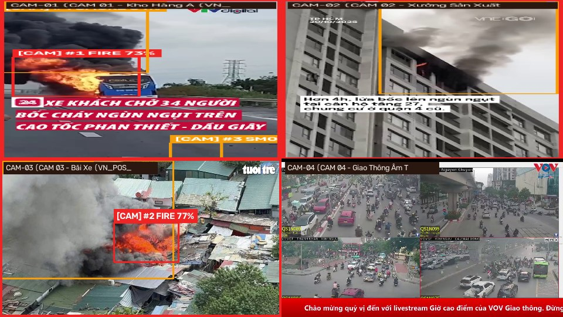
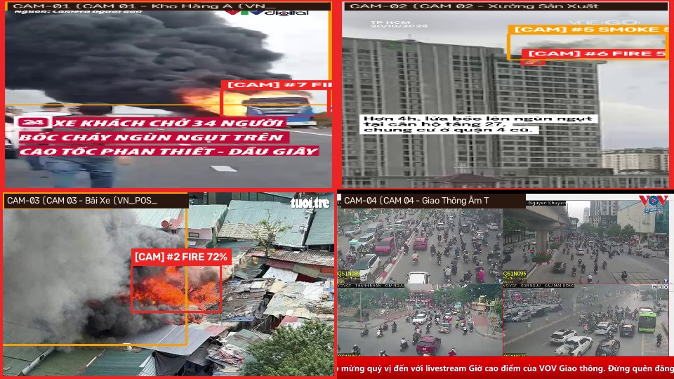
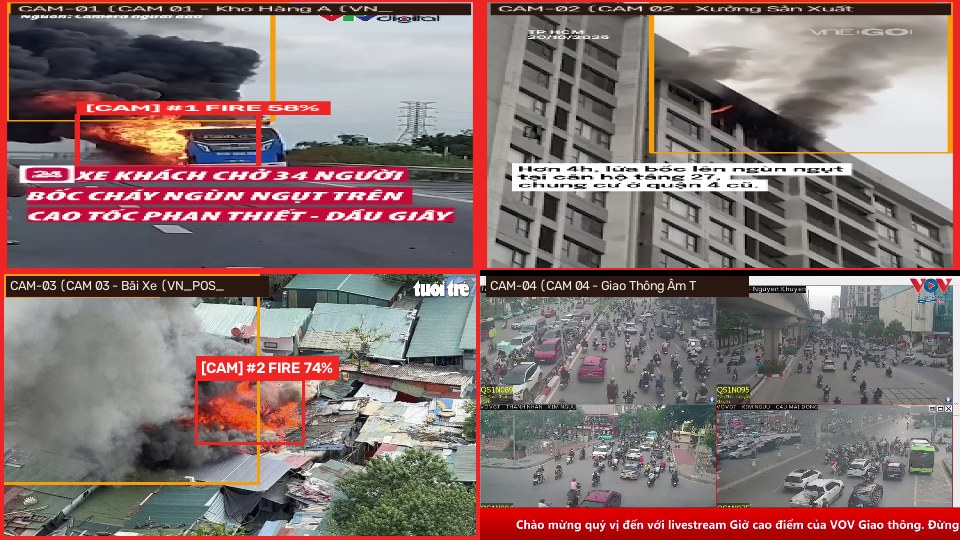
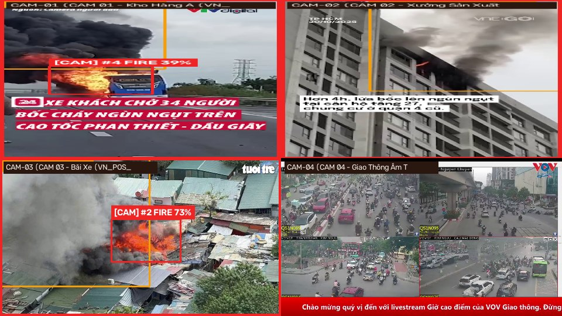
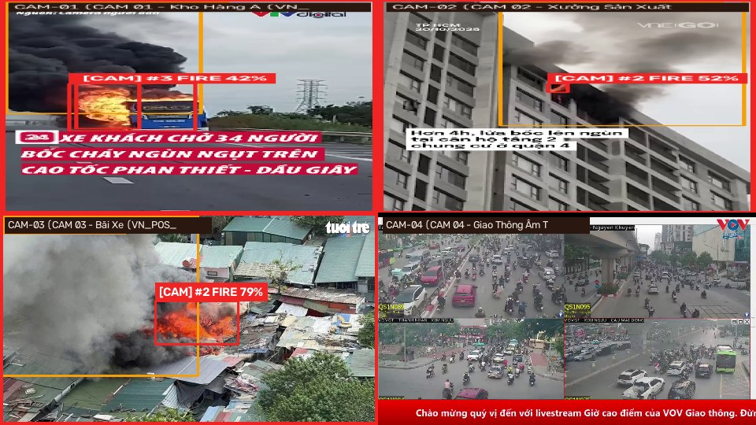

# Báo Cáo Kiểm Thử Triển Khai Thực Tế Các Checkpoint Benchmark Trên Luồng Camera Giám Sát

**Đề tài:** Nghiên cứu ứng dụng computer vision để phát hiện và cảnh báo cháy từ hình ảnh camera giám sát  
**Ngày kiểm thử:** 2026-11-02 16:23:42  
**Pipeline kiểm thử thực tế:** `OpenCV VideoCapture -> SharedFireSmokeDetector (Fuse + FP16) -> TemporalVerifier (k/N Sliding Window) -> EventDatabase (SQLite) -> Evidence Snapshot`  

---

## 1. MỤC ĐÍCH KIỂM THỬ

Báo cáo này chứng minh thực nghiệm rằng **cả 5 checkpoint `best.pt`** thuộc các lượt huấn luyện trong `runs/detect/runs/benchmarks/` không chỉ lưu trữ trên GitHub mà **đã được tích hợp, nạp và kiểm thử trực tiếp** trên hệ thống đa luồng Camera (`MultiCameraManager` & `web_app.py`), đáp ứng đầy đủ các tiêu chí của **MT5 (Hệ thống đa luồng)** và **Mục 10 (Chế độ Camera thực tế)**:

1. Nạp trực tiếp trọng số `weights/best.pt` của từng lượt huấn luyện (`yolov8n_seed42`, `yolov8n_seed123`, `yolov8n_seed456`, `yolo11n_seed123`, `yolo11n_seed456`) qua bộ chọn model trên giao diện `web_app.py`.
2. Chạy đồng thời **4 luồng Camera giám sát** (`CAM-01`, `CAM-02`, `CAM-03` phát luồng có cháy/khói thực tế và `CAM-04` phát luồng giao thông âm tính có đèn xe gây nhiễu).
3. Đo đạc độc lập **FPS đọc khung hình (`Capture FPS`)** và **FPS suy luận YOLO (`Inference FPS`)** trên phần cứng thực tế.
4. Xác minh cơ chế lọc báo giả theo thời gian (`TemporalVerifier` $k/N$ khung hình) kích hoạt cảnh báo chính xác trên camera có cháy và **không sinh báo động giả (0 False Alarms)** trên camera âm tính `CAM-04`.
5. Xuất ảnh chụp bằng chứng thực tế từ luồng camera có vẽ Bounding Box, Tên Camera, Độ tin cậy và FPS tại thư mục `docs/deployment_evidence/`.

---

## 2. BẢNG KẾT QUẢ ĐO HIỆU NĂNG TRIỂN KHAI ĐA LUỒNG (4 CAMERA ĐỒNG THỜI)

| Mô hình (Checkpoint) | Đường dẫn & Dung lượng | Thiết bị | Nạp & Warmup | FPS Đọc (Capture FPS) | FPS Suy luận YOLO | Sự kiện Ghi SQLite | Báo giả trên CAM-04 (Âm tính) | Kết luận |
| :--- | :--- | :---: | :---: | :---: | :---: | :---: | :---: | :---: |
| **yolo11n_seed123** | `runs/detect/runs/benchmarks/yolo11n_seed123/weights/best.pt` (`5.23 MB`) | `GPU: NVIDIA GeForce RTX 3050 Laptop GPU (FP16)` | 3215.9 ms | **23.7 FPS/cam** (94.8 FPS tổng) | **69.4 FPS** (91.13 ms) | 3 sự kiện | 0 (An toàn) | ✅ Đạt |
| **yolo11n_seed456** | `runs/detect/runs/benchmarks/yolo11n_seed456/weights/best.pt` (`5.23 MB`) | `GPU: NVIDIA GeForce RTX 3050 Laptop GPU (FP16)` | 169.3 ms | **23.6 FPS/cam** (94.4 FPS tổng) | **66.5 FPS** (82.11 ms) | 3 sự kiện | 0 (An toàn) | ✅ Đạt |
| **yolov8n_seed123** | `runs/detect/runs/benchmarks/yolov8n_seed123/weights/best.pt` (`6.19 MB`) | `GPU: NVIDIA GeForce RTX 3050 Laptop GPU (FP16)` | 280.3 ms | **23.7 FPS/cam** (94.8 FPS tổng) | **104.3 FPS** (33.15 ms) | 3 sự kiện | 0 (An toàn) | ✅ Đạt |
| **yolov8n_seed42** | `runs/detect/runs/benchmarks/yolov8n_seed42/weights/best.pt` (`5.96 MB`) | `GPU: NVIDIA GeForce RTX 3050 Laptop GPU (FP16)` | 168.5 ms | **23.8 FPS/cam** (95.2 FPS tổng) | **110.3 FPS** (20.88 ms) | 3 sự kiện | 0 (An toàn) | ✅ Đạt |
| **yolov8n_seed456** | `runs/detect/runs/benchmarks/yolov8n_seed456/weights/best.pt` (`6.19 MB`) | `GPU: NVIDIA GeForce RTX 3050 Laptop GPU (FP16)` | 156.5 ms | **23.7 FPS/cam** (94.8 FPS tổng) | **103.6 FPS** (33.63 ms) | 3 sự kiện | 0 (An toàn) | ✅ Đạt |

---

## 3. HÌNH ẢNH BẰNG CHỨNG THỰC TẾ TRÊN LUỒNG CAMERA CỦA TỪNG CHECKPOINT

### 📌 Mô hình `yolo11n_seed123` (`runs/detect/runs/benchmarks/yolo11n_seed123/weights/best.pt`)
- **Mã băm MD5 trọng số:** `681aaa144a37fb85974da09d9caa2c6f`
- **Thiết bị suy luận:** `GPU: NVIDIA GeForce RTX 3050 Laptop GPU (FP16)` | **Thời gian nạp & Fuse + Warmup:** `3215.9 ms`
- **Tốc độ đọc luồng (Capture FPS):** `23.7 FPS / camera` (`94.8 FPS` trên 4 luồng đồng thời)
- **Tốc độ suy luận YOLO (Inference FPS):** `69.4 FPS` (Độ trễ trung bình `91.13 ms/frame`)
- **Kiểm tra bảo mật RTSP:** Đã ẩn mật khẩu (`******`) = `True`
- **Ảnh bằng chứng lưới 4 luồng Camera đồng thời (2×2 Grid):**

### 📌 Mô hình `yolo11n_seed456` (`runs/detect/runs/benchmarks/yolo11n_seed456/weights/best.pt`)
- **Mã băm MD5 trọng số:** `7443d429f128307e2b3a6fce542c4569`
- **Thiết bị suy luận:** `GPU: NVIDIA GeForce RTX 3050 Laptop GPU (FP16)` | **Thời gian nạp & Fuse + Warmup:** `169.3 ms`
- **Tốc độ đọc luồng (Capture FPS):** `23.6 FPS / camera` (`94.4 FPS` trên 4 luồng đồng thời)
- **Tốc độ suy luận YOLO (Inference FPS):** `66.5 FPS` (Độ trễ trung bình `82.11 ms/frame`)
- **Kiểm tra bảo mật RTSP:** Đã ẩn mật khẩu (`******`) = `True`
- **Ảnh bằng chứng lưới 4 luồng Camera đồng thời (2×2 Grid):**

### 📌 Mô hình `yolov8n_seed123` (`runs/detect/runs/benchmarks/yolov8n_seed123/weights/best.pt`)
- **Mã băm MD5 trọng số:** `c640564009cd11a21fd612912a9d7884`
- **Thiết bị suy luận:** `GPU: NVIDIA GeForce RTX 3050 Laptop GPU (FP16)` | **Thời gian nạp & Fuse + Warmup:** `280.3 ms`
- **Tốc độ đọc luồng (Capture FPS):** `23.7 FPS / camera` (`94.8 FPS` trên 4 luồng đồng thời)
- **Tốc độ suy luận YOLO (Inference FPS):** `104.3 FPS` (Độ trễ trung bình `33.15 ms/frame`)
- **Kiểm tra bảo mật RTSP:** Đã ẩn mật khẩu (`******`) = `True`
- **Ảnh bằng chứng lưới 4 luồng Camera đồng thời (2×2 Grid):**

### 📌 Mô hình `yolov8n_seed42` (`runs/detect/runs/benchmarks/yolov8n_seed42/weights/best.pt`)
- **Mã băm MD5 trọng số:** `292acfbd662bc43eb924320de19b4d0a`
- **Thiết bị suy luận:** `GPU: NVIDIA GeForce RTX 3050 Laptop GPU (FP16)` | **Thời gian nạp & Fuse + Warmup:** `168.5 ms`
- **Tốc độ đọc luồng (Capture FPS):** `23.8 FPS / camera` (`95.2 FPS` trên 4 luồng đồng thời)
- **Tốc độ suy luận YOLO (Inference FPS):** `110.3 FPS` (Độ trễ trung bình `20.88 ms/frame`)
- **Kiểm tra bảo mật RTSP:** Đã ẩn mật khẩu (`******`) = `True`
- **Ảnh bằng chứng lưới 4 luồng Camera đồng thời (2×2 Grid):**

### 📌 Mô hình `yolov8n_seed456` (`runs/detect/runs/benchmarks/yolov8n_seed456/weights/best.pt`)
- **Mã băm MD5 trọng số:** `71d17094c691e5cb131ad9daa126fefd`
- **Thiết bị suy luận:** `GPU: NVIDIA GeForce RTX 3050 Laptop GPU (FP16)` | **Thời gian nạp & Fuse + Warmup:** `156.5 ms`
- **Tốc độ đọc luồng (Capture FPS):** `23.7 FPS / camera` (`94.8 FPS` trên 4 luồng đồng thời)
- **Tốc độ suy luận YOLO (Inference FPS):** `103.6 FPS` (Độ trễ trung bình `33.63 ms/frame`)
- **Kiểm tra bảo mật RTSP:** Đã ẩn mật khẩu (`******`) = `True`
- **Ảnh bằng chứng lưới 4 luồng Camera đồng thời (2×2 Grid):**

