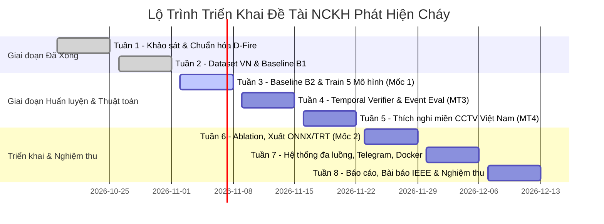

# Kế Hoạch & Quy Trình Triển Khai Chi Tiết Từ Tuần 3 Đến Tuần 8

**Đề tài:** Nghiên cứu ứng dụng computer vision để phát hiện và cảnh báo cháy từ hình ảnh camera giám sát  
**Giảng viên hướng dẫn:** ThS. Nguyễn Hữu Trung  
**Nhóm thực hiện:** Lê Minh Thiên (Chủ nhiệm), Mai Quốc Việt (Thành viên chính)  
**Thời gian thực hiện:** 8 tuần (19/10/2026 – 13/12/2026)  
**Hiện trạng:** Đã hoàn thành $100\%$ Tuần 1 và Tuần 2 (Chuẩn hóa D-Fire, Bộ video kiểm định, 1.050 ảnh Ground Truth Việt Nam, Baseline B1).

---

## 🗺️ LỘ TRÌNH TỔNG QUAN CÁC TUẦN TIẾP THEO

---

## 📌 CHI TIẾT KẾ HOẠCH TỪNG TUẦN

### 🗓️ TUẦN 3 (02/11 – 08/11/2026): BASELINE B2 & HUẤN LUYỆN 5 MÔ HÌNH PHÁT HIỆN
🎯 **Mục tiêu chỉ tiêu (MT2):**
- Xây dựng Baseline B2 (MobileNetV3).
- Huấn luyện $\ge 4$ mô hình: **YOLOv8n**, **YOLOv8s**, **YOLO11n**, **YOLO11s**, **RT-DETR-R18** trên tập chuẩn D-Fire (21.527 ảnh).
- Chỉ tiêu chất lượng: $mAP@0.5 \ge 0,75$ trên D-Fire; 3 seed ngẫu nhiên (báo cáo mean $\pm$ std).
- 🚩 **Mốc kiểm tra 1 với GVHD ThS. Nguyễn Hữu Trung.**

| Nhiệm vụ cụ thể | Script / File phụ trách | Người phụ trách |
| :--- | :--- | :--- |
| **1. Cài đặt Baseline B2:** Xây dựng mạng phân loại ảnh nhẹ MobileNetV3-Small (Frame-level classification). | `baselines/baseline_b2_mobilenet.py` `baselines/evaluate_b2.py` | Lê Minh Thiên |
| **2. Pipeline huấn luyện thống nhất:** Cùng `imgsz=640`, cùng số epoch (50/100), cùng hyperparameter & augmentations trên 3 random seed (42, 123, 456). | `scripts/train_benchmarks.py` | Lê Minh Thiên, Mai Quốc Việt |
| **3. Huấn luyện các mô hình trên D-Fire:** • YOLOv8n, YOLOv8s • YOLO11n, YOLO11s • RT-DETR-R18 | Lưu checkpoint tại: `runs/train/yolov8n_dfire/` `runs/train/yolo11n_dfire/`... | Lê Minh Thiên |
| **4. Bảng tổng hợp đối sánh MT2:** So sánh Params, FLOPs, Latency (ms), Throughput (FPS), $mAP@0.5$, $mAP@0.5:0.95$. | `docs/benchmark_detectors_dfire.md` | Nhóm nghiên cứu |

---

### 🗓️ TUẦN 4 (09/11 – 15/11/2026): XÁC NHẬN THEO THỜI GIAN & ĐÁNH GIÁ SỰ KIỆN
🎯 **Mục tiêu chỉ tiêu (MT3 - Cốt lõi sáng tạo đề tài):**
- Giảm $\ge 50\%$ số lần báo động giả/giờ so với cảnh báo từng khung đơn lẻ.
- Recall sự kiện giảm $\le 5$ điểm phần trăm; Độ trễ phát hiện trung bình $\le 10$ giây.

| Nhiệm vụ cụ thể | Script / File phụ trách | Người phụ trách |
| :--- | :--- | :--- |
| **1. Bộ theo dõi ByteTrack:** Gán ID duy nhất và liên kết bounding box khói/lửa qua thời gian. | `src/temporal_verifier.py` (Class `TemporalVerifier`) | Mai Quốc Việt |
| **2. Cửa sổ trượt $k/N$ khung hình:** Quét tìm các tham số tối ưu (vd: 6/10, 8/12, 10/15) trên tập kiểm định. | `src/temporal_verifier.py` | Mai Quốc Việt |
| **3. Phân tích biến động đặc trưng:** Tính độ biến thiên diện tích, chu vi hộp bao qua các khung để khử nguồn sáng tĩnh. | `src/temporal_verifier.py` | Mai Quốc Việt |
| **4. Cơ chế 2 mức cảnh báo:** Mức 1 "Nghi ngờ" (Suspect) & Mức 2 "Báo cháy" (Fire Alert). | `src/temporal_verifier.py` | Mai Quốc Việt |
| **5. Module đánh giá sự kiện:** Đo đạc trên bộ 60 video kiểm định (`video_dataset_list.csv`): Event Recall, Độ trễ (s), Báo giả/giờ. | `src/event_eval.py` `docs/temporal_verification_report.md` | Mai Quốc Việt |

---

### 🗓️ TUẦN 5 (16/11 – 22/11/2026): THÍCH NGHI MIỀN TRÊN BỐI CẢNH CAMERA VIỆT NAM
🎯 **Mục tiêu chỉ tiêu (MT4):**
- Thích nghi từ miền D-Fire (ảnh mở phương Tây) sang miền camera giám sát Việt Nam (`datasets/vn_dataset/`).
- Tăng $\ge 5$ điểm $mAP@0.5$ trên tập test Việt Nam; $mAP$ trên D-Fire giảm $\le 2$ điểm (tránh quên thảm khốc).

| Nhiệm vụ cụ thể | Script / File phụ trách | Người phụ trách |
| :--- | :--- | :--- |
| **1. Đánh giá Zero-shot:** Đo mAP của mô hình tốt nhất từ Tuần 3 trên tập `datasets/vn_dataset/images/test/` (chưa thích nghi). | `scripts/evaluate_domain.py` | Lê Minh Thiên |
| **2. Thực nghiệm Chiến lược 1:** Fine-tuning toàn bộ trọng số mạng (Full Fine-tuning). | `scripts/train_domain_adaptation.py --strategy full` | Lê Minh Thiên |
| **3. Thực nghiệm Chiến lược 2:** Đóng băng tầng Backbone, chỉ tinh chỉnh Neck & Head. | `scripts/train_domain_adaptation.py --strategy freeze_backbone` | Lê Minh Thiên |
| **4. Thực nghiệm Chiến lược 3:** Đóng băng Backbone kết hợp Replay 20% dữ liệu D-Fire (Experience Replay). | `scripts/train_domain_adaptation.py --strategy replay_20` | Lê Minh Thiên |
| **5. Đánh giá hiện tượng quên (Catastrophic Forgetting):** Đo mAP đồng thời trên cả 2 tập (VN Test + D-Fire Test). | `docs/domain_adaptation_report.md` | Lê Minh Thiên, Mai Quốc Việt |

---

### 🗓️ TUẦN 6 (23/11 – 29/11/2026): ABLATION STUDY, XUẤT MÔ HÌNH & ĐO HIỆU NĂNG BIÊN
🎯 **Mục tiêu chỉ tiêu:**
- Nghiên cứu cắt bỏ (Ablation study) chứng minh đóng góp từng thành phần.
- Phân tích chi tiết $\ge 50$ trường hợp lỗi (Error Analysis).
- Xuất mô hình tối ưu (ONNX, OpenVINO, TensorRT FP16), đo FPS đa nền tảng.
- 🚩 **Mốc kiểm tra 2 với GVHD ThS. Nguyễn Hữu Trung.**

| Nhiệm vụ cụ thể | Script / File phụ trách | Người phụ trách |
| :--- | :--- | :--- |
| **1. Ablation Study:** Thử nghiệm lần lượt bật/tắt ByteTrack, cửa sổ $k/N$, Feature dynamics, ROI Masking. | `scripts/ablation_study.py` | Mai Quốc Việt |
| **2. Phân tích $\ge 50$ ca lỗi:** Trích xuất ảnh & phân tích nguyên nhân các ca False Positive (đèn xe, nắng) và False Negative (khói mờ). | `docs/error_analysis_50_cases.md` | Mai Quốc Việt, Lê Minh Thiên |
| **3. Xuất mô hình tối ưu:** Xuất checkpoint tốt nhất sang ONNX, OpenVINO IR, và TensorRT FP16 engine. | `scripts/export_models.py` | Mai Quốc Việt |
| **4. Đo tốc độ chi tiết:** Benchmarking FPS và Latency trên GPU RTX 3050 và CPU Intel. | `scripts/benchmark_fps.py` `docs/hardware_benchmarks.md` | Mai Quốc Việt |

---

### 🗓️ TUẦN 7 (30/11 – 06/12/2026): HỆ THỐNG ĐA LUỒNG, TELEGRAM/EMAIL, DASHBOARD & DOCKER
🎯 **Mục tiêu chỉ tiêu (MT5):**
- Hệ thống xử lý $\ge 4$ luồng RTSP đồng thời.
- Tốc độ xử lý: $\ge 15$ FPS/luồng trên GPU, $\ge 5$ FPS trên CPU (ONNX/OpenVINO).
- Gửi cảnh báo kèm snapshot tới điện thoại $\le 5$ giây.
- Đóng gói Docker, chạy thử nghiệm liên tục $\ge 2$ giờ không tràn RAM / crash.

| Nhiệm vụ cụ thể | Script / File phụ trách | Người phụ trách |
| :--- | :--- | :--- |
| **1. Giả lập $\ge 4$ luồng RTSP:** Thiết lập MediaMTX stream video từ test videos. | `docker/mediamtx.yml` `scripts/start_rtsp_streams.bat` | Mai Quốc Việt |
| **2. Quản lý camera đa tiến trình:** Kiến trúc Producer-Consumer đa luồng (Queue, Multiprocessing). | `src/multi_stream_manager.py` | Mai Quốc Việt |
| **3. Gửi cảnh báo Telegram & Email:** Bot Telegram gửi tin nhắn khẩn cấp kèm ảnh snapshot có bounding box $\le 5$s. | `src/alert_notifier.py` | Mai Quốc Việt |
| **4. Dashboard giám sát thời gian thực:** Nâng cấp Web App hiển thị cùng lúc 4 camera, lịch sử báo động SQLite, nút tắt còi / bỏ qua. | `web_app.py` `app.py` | Mai Quốc Việt |
| **5. Đóng gói Docker & Stress Test 2 giờ:** Chạy liên tục hệ thống $\ge 2$ giờ, giám sát tài nguyên CPU/GPU/RAM. | `Dockerfile` `docker-compose.yml` `docs/stress_test_report.md` | Mai Quốc Việt |

---

### 🗓️ TUẦN 8 (07/12 – 13/12/2026): BÁO CÁO TỔNG KẾT, BÀI BÁO IEEE & NGHIỆM THU
🎯 **Mục tiêu chỉ tiêu:**
- Bài báo khoa học định dạng IEEE 6–8 trang hoàn chỉnh.
- Báo cáo tổng kết đề tài NCKH, Slide thuyết trình, Video demo hệ thống.
- Nghiệm thu đề tài đạt kết quả xuất sắc.

| Nhiệm vụ cụ thể | Sản phẩm bàn giao | Người phụ trách |
| :--- | :--- | :--- |
| **1. Bài báo khoa học chuẩn IEEE:** Biên soạn 6–8 trang bằng LaTeX/Word theo mẫu IEEE Conference. | `papers/IEEE_Fire_Detection_CCTV.pdf` | Lê Minh Thiên (Chủ biên), Mai Quốc Việt |
| **2. Báo cáo tổng kết đề tài NCKH:** Đầy đủ các chương theo quy định của Phòng QLKH. | `reports/BaoCao_TongKet_NCKH.docx` | Nhóm nghiên cứu |
| **3. Video demo & Slide nghiệm thu:** Video quay lại hệ thống bắt cháy thực tế, trễ $\le 5$s, giao diện đa luồng và Telegram Bot. | `slides/Slide_NghiemThu_NCKH.pptx` `videos/demo_final.mp4` | Mai Quốc Việt |
| **4. Hoàn thiện Repository Git:** Làm sạch Repo, cập nhật README.md hướng dẫn cài đặt và chạy thử 1 click. | `README.md` | Mai Quốc Việt |

---

## 🚀 HÀNH ĐỘNG NGAY BÂY GIỜ

Để bắt đầu ngay **Tuần 3**, công việc đầu tiên cần thực hiện là:
👉 **Xây dựng Baseline B2 (Mạng phân loại nhẹ MobileNetV3-Small)** và thiết lập pipeline huấn luyện các mô hình.
