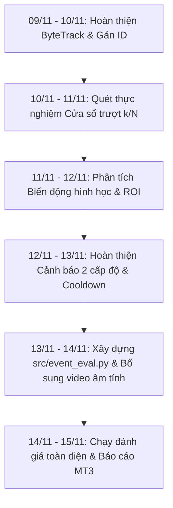

# Kế Hoạch Triển Khai Tuần 4: Temporal Verifier & Đánh Giá Sự Kiện (MT3)

**Thời gian thực hiện:** 09/11/2026 – 15/11/2026  
**Đề tài:** Nghiên cứu ứng dụng computer vision để phát hiện và cảnh báo cháy từ hình ảnh camera giám sát  
**Trọng tâm:** Tối ưu hóa chuỗi thời gian (Temporal Verifier) để giảm báo động giả từ các nguồn gây nhiễu (đèn xe, ánh nắng phản chiếu, chuyển động ngẫu nhiên) và xây dựng hệ thống đánh giá sự kiện (`event_eval.py`).  
**Người phụ trách chính:** Mai Quốc Việt (theo phân công trong Đề cương NCKH).

---

## 1. MỤC TIÊU CỐT LÕI (CHỈ TIÊU MT3)

| Chỉ tiêu khoa học | Yêu cầu Đề cương | Phương pháp đo đạc & kiểm chứng |
| :--- | :---: | :--- |
| **Giảm báo động giả/giờ** | $\ge \mathbf{50\%}$ | So sánh số sự kiện báo sai/giờ giữa phương pháp phát hiện từng khung hình (Frame-by-frame) và khi có `TemporalVerifier` trên tập video âm tính. |
| **Event Recall (Độ bao phủ sự kiện)** | Giảm $\le \mathbf{5}$ điểm % | Tỷ lệ phát hiện thành công sự kiện cháy/khói thật sự trên tập video dương tính không được sụt giảm quá 5% so với frame-level. |
| **Độ trễ phát hiện trung bình** | $\le \mathbf{10}$ giây | Tính từ mốc giây bắt đầu có cháy/khói (`fire_start_sec`, `smoke_start_sec`) đến khi hệ thống nâng cấp lên mức cảnh báo `FIRE`. |

---

## 2. HIỆN TRẠNG KỸ THUẬT & DANH MỤC CÔNG VIỆC TUẦN 4

| Hạng mục | Hiện trạng code | Việc cần hoàn thiện trong Tuần 4 |
| :--- | :--- | :--- |
| **1. Tracking ID** | Đã có IoU Tracking nhẹ trong `src/temporal_verifier.py` | Kiểm thử cơ chế gán ID, xử lý mất dấu tạm thời (Lost tracks) và liên kết liên tục các hộp bao. |
| **2. Cửa sổ trượt $k/N$** | Đã có cấu hình mặc định (vd: 4/10) | Quét thực nghiệm so sánh ít nhất 3 cấu hình: `6/10`, `8/12`, `10/15` trên tập video kiểm định để tìm điểm cân bằng Pareto giữa độ trễ và báo giả. |
| **3. Biến động hình học** | Đã lưu lịch sử diện tích và tâm hộp bao | Tính độ biến thiên diện tích ($\Delta \text{Area}$), chu vi, độ giật vị trí tâm để phân biệt lửa thật (cháy lan, nhấp nháy) với bóng đèn xe hoặc biển quảng cáo tĩnh. |
| **4. Hai cấp độ cảnh báo** | Đã có logic `SUSPECT` $\to$ `FIRE` | Hoàn thiện máy trạng thái chuyển mức, tích hợp Cooldown và chống tạo nhiều sự kiện trùng lặp cho cùng một đám cháy. |
| **5. Vùng loại trừ ROI** | Đã có logic loại trừ hộp bao | Kiểm tra độ tương thích trên từng camera thực tế để bỏ qua vùng đèn đường hoặc ống xả cố định. |
| **6. Event Evaluator** | **Chưa có file** | **Xây dựng mới `src/event_eval.py`** để chạy tự động trên toàn bộ video kiểm định, đối chiếu mốc ground truth và tính toán đầy đủ các chỉ số MT3. |
| **7. Dữ liệu video âm tính** | Đang có 28 video (~2,865 giờ) | Bổ sung thêm ~2 giờ 08 phút video âm tính (giao thông, bóng nắng, đèn led, sinh hoạt) để đạt đúng $\ge 5$ giờ theo chỉ tiêu MT1. |
| **8. Báo cáo MT3** | Chưa tạo | Xuất báo cáo khoa học chuẩn IEEE tại `docs/temporal_verification_report.md`. |

---

## 3. LỊCH TRÌNH CHI TIẾT THEO NGÀY (09/11 – 15/11/2026)

### 📅 Ngày 1 & 2 (09/11 – 10/11): Hoàn thiện Bộ theo dõi đối tượng
- Kiểm tra tính ổn định của cơ chế gán ID (`track_id`).
- Xử lý trường hợp đối tượng lửa/khói bị che khuất nhẹ hoặc mất dấu trong 1-2 khung hình rồi xuất hiện lại (`max_lost_frames`).
- Tách biệt theo dõi giữa hai lớp `FIRE` và `SMOKE`.

### 📅 Ngày 2 & 3 (10/11 – 11/11): Tối ưu hóa Cửa sổ trượt $k/N$
- Thử nghiệm 3 cấu hình chuẩn:
  - Cấu hình 1 (Phản ứng nhanh): $k/N = 6/10$
  - Cấu hình 2 (Cân bằng): $k/N = 8/12$
  - Cấu hình 3 (Chống báo giả cao): $k/N = 10/15$
- Đo đạc tỷ lệ phát hiện sớm và số lần kích hoạt nhầm trên các đoạn clip ánh sáng phức tạp.

### 📅 Ngày 3 & 4 (11/11 – 12/11): Phân tích Biến động hình học & Vùng loại trừ ROI
- Theo dõi độ biến thiên diện tích hộp bao: ngọn lửa thực tế luôn có sự dao động diện tích và bốc cao, trong khi đèn xe hoặc đốm sáng tĩnh có diện tích gần như không đổi.
- Hoàn thiện công cụ vẽ vùng ROI loại trừ theo từng camera trong file cấu hình.

### 📅 Ngày 4 & 5 (12/11 – 13/11): Hoàn thiện Cảnh báo 2 cấp độ & Cooldown
- Cấp độ 1 (`SUSPECT`): Đạt $k_{suspect}$ khung hình $\rightarrow$ Kích hoạt theo dõi chặt chẽ, chưa báo động chuông.
- Cấp độ 2 (`FIRE`): Đạt $k_{confirm}$ khung hình kèm xác nhận biến động $\rightarrow$ Kích hoạt chuông còi, ghi nhận sự kiện vào CSDL SQLite và chụp ảnh snapshot.
- Áp dụng `cooldown_sec` để ngăn chặn việc spam hàng trăm cảnh báo cho cùng một đám cháy đang diễn ra.

### 📅 Ngày 5 & 6 (13/11 – 14/11): Xây dựng `src/event_eval.py` & Bổ sung Video Âm tính
- Xây dựng module đánh giá sự kiện `src/event_eval.py`:
  - Đọc file danh mục `data/video_dataset_list.csv`.
  - Chạy mô hình qua từng video, ghi nhận thời điểm phát sinh cảnh báo đầu tiên ($T_{detect}$).
  - Tính toán:
    - **Event Recall:** Tỷ lệ video có cháy được phát hiện trước khi video kết thúc.
    - **Mean Detection Latency (Độ trễ trung bình):** $\frac{1}{N_{det}} \sum (T_{detect} - T_{start})$.
    - **False Alarm Rate (Báo giả/giờ):** $\frac{\text{Số lần báo sai trên video âm tính}}{\text{Tổng số giờ video âm tính}}$.
- Bổ sung thêm ~2 giờ 08 phút video âm tính (camera đường phố, công viên, nhà xưởng ban đêm có đèn pha) để đủ $\ge 5$ giờ âm tính theo đúng MT1.

### 📅 Ngày 6 & 7 (14/11 – 15/11): Chạy Thực nghiệm Đối sánh & Xuất Báo cáo MT3
- Chạy đối sánh song song 2 phương pháp trên toàn bộ 72+ video:
  - Phương pháp Baseline: Báo động ngay trên từng khung hình đơn lẻ (Frame-by-frame).
  - Phương pháp Đề xuất: `YOLO + TemporalVerifier (ByteTrack + k/N + Biến động hình học)`.
- Lập bảng so sánh định lượng: Giảm báo giả ($\ge 50\%$), Event Recall ($\Delta \le 5\%$), Độ trễ ($\le 10s$).
- Xuất báo cáo tổng kết khoa học tại `docs/temporal_verification_report.md`.

---

## 4. CHECKLIST NGHIỆM THU TUẦN 4 (MT3)

- [ ] `[ ]` **Check 1:** Kiểm thử và hoàn thiện cơ chế gán ID cho đối tượng lửa/khói (`src/temporal_verifier.py`).
- [ ] `[ ]` **Check 2:** Thực nghiệm quét tối thiểu 3 cấu hình cửa sổ trượt ($6/10$, $8/12$, $10/15$).
- [ ] `[ ]` **Check 3:** Cài đặt thuật toán phân tích biến động diện tích/chu vi hộp bao để lọc nguồn sáng tĩnh.
- [ ] `[ ]` **Check 4:** Hoàn thiện cơ chế 2 mức cảnh báo (`SUSPECT` $\to$ `FIRE`).
- [ ] `[ ]` **Check 5:** Kiểm thử vùng loại trừ ROI và cơ chế Cooldown chống báo lặp.
- [ ] `[ ]` **Check 6:** Xây dựng mới hoàn chỉnh script đánh giá sự kiện `src/event_eval.py`.
- [ ] `[ ]` **Check 7:** Bổ sung thêm $\ge 2$ giờ 08 phút video âm tính để đạt mốc $\ge 5$ giờ âm tính chuẩn MT1.
- [ ] `[ ]` **Check 8:** Chạy đánh giá sự kiện trên toàn bộ danh mục video kiểm định.
- [ ] `[ ]` **Check 9:** Đạt chỉ tiêu **Giảm $\ge 50\%$ số lần báo động giả/giờ** so với cảnh báo từng khung.
- [ ] `[ ]` **Check 10:** Đạt chỉ tiêu **Event Recall giảm không quá 5 điểm %** và **Độ trễ TB $\le 10$ giây**.
- [ ] `[ ]` **Check 11:** Hoàn thiện báo cáo khoa học `docs/temporal_verification_report.md`.

