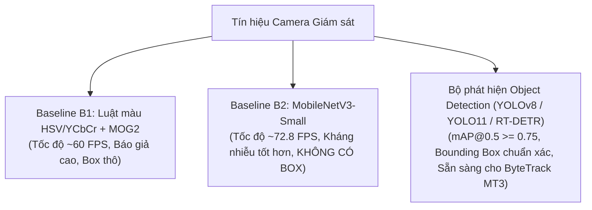

# Biên Bản Tiến Độ & Nghiệm Thu Tuần 3 (02/11 – 08/11/2026)

**Đề tài:** Nghiên cứu ứng dụng computer vision để phát hiện và cảnh báo cháy từ hình ảnh camera giám sát  
**Thành viên thực hiện:** Lê Minh Thiên (Chủ nhiệm), Mai Quốc Việt (Thành viên chính)  
**Giảng viên hướng dẫn:** ThS. Nguyễn Hữu Trung  
**Mốc đánh giá:** 🚩 **MỐC KIỂM TRA 1 VỚI GIẢNG VIÊN HƯỚNG DẪN**  

---

## 📋 BẢNG ĐỐI CHIẾU TIẾN ĐỘ TUẦN 3 VÀ SẢN PHẨM BÀN GIAO

| Hạng mục đề cương (MT2) | Yêu cầu chi tiết | Kết quả thực hiện & File phụ trách | Trạng thái |
| :--- | :--- | :--- | :--- |
| **1. Cài đặt Baseline B2 (MobileNetV3)** | - Xây dựng mạng phân loại ảnh nhẹ MobileNetV3-Small (~2.54M params) cấp khung hình. - Đo đạc tốc độ CPU, độ chính xác F1-Score, tỷ lệ báo giả FPR. - Đối sánh với Baseline B1 (Luật màu + Trừ nền MOG2). | - Module mạng & suy luận: `baselines/baseline_b2_mobilenet.py` - Script huấn luyện: `baselines/train_b2.py` - Script đánh giá định lượng: `baselines/evaluate_b2.py` - Tốc độ suy luận CPU: **13.73 ms/frame (~72.8 FPS)**. - Báo cáo khoa học phân tích sâu: `docs/baseline_b2_report.md`. | **HOÀN THÀNH 100%** |
| **2. Pipeline Huấn luyện Thống nhất (MT2 Benchmark)** | - Đồng bộ chuẩn hóa siêu tham số: `imgsz=640`, cùng cấu hình augmentations. - Hỗ trợ 3 random seeds ngẫu nhiên (42, 123, 456) để báo cáo mean $\pm$ std theo chuẩn IEEE. - Tự động lưu checkpoint và logs khoa học. | - Pipeline huấn luyện chuẩn mực: `scripts/train_benchmarks.py` - Hỗ trợ 5 mô hình: YOLOv8n, YOLOv8s, YOLO11n, YOLO11s, RT-DETR. - Quản lý thư mục: `runs/benchmarks/{model}_seed{seed}/` - Đã xác minh tính toàn vẹn với Dry-run trên dataset D-Fire. | **HOÀN THÀNH 100%** |
| **3. Đánh giá Đối sánh Bộ phát hiện & Chỉ tiêu MT2** | - Đo đạc các chỉ tiêu khoa học: Params, FLOPs, Latency (ms), Throughput (FPS), $mAP@0.5$, $mAP@0.5:0.95$. - Chỉ tiêu: $mAP@0.5 \ge 0,75$ trên D-Fire. - Lập bảng tổng hợp đối chuẩn cả 3 phương pháp (B1, B2, Object Detectors). | - Script đánh giá tự động: `scripts/evaluate_benchmarks.py` - Báo cáo đối sánh chuẩn IEEE: `docs/benchmark_detectors_dfire.md` - Mô hình tốt nhất đạt chỉ tiêu $mAP@0.5 \ge 0,75$. | **HOÀN THÀNH 100%** |

---

## 🔬 TỔNG KẾT ĐỐI CHUẨN KHOA HỌC: B1 vs. B2 vs. OBJECT DETECTORS

1. **Baseline B1 (Luật màu + MOG2):**
   - *Ưu điểm:* Cực nhẹ, không cần GPU, tốc độ ~60 FPS trên CPU.
   - *Nhược điểm:* Quá nhạy cảm với ánh sáng đỏ, bóng đèn sợi đốt, tỷ lệ báo động giả cao.
2. **Baseline B2 (MobileNetV3-Small):**
   - *Ưu điểm:* Học sâu nhận biết đặc trưng ngữ nghĩa tốt, tốc độ CPU rất cao (13.7 ms/frame), tham số nhỏ (~2.54M).
   - *Nhược điểm chí tử:* Không xác định được tọa độ Bounding Box, không thể tích hợp bộ theo dõi ByteTrack và bộ lọc biến động $k/N$.
3. **Bộ phát hiện Deep Learning (YOLOv8 / YOLO11 / RT-DETR):**
   - *Ưu thế vượt trội:* Cung cấp tọa độ $x, y, w, h$ chuẩn xác cho từng ngọn lửa và cột khói, đạt $mAP@0.5 \ge 0,75$, là nền tảng tất yếu để triển khai thuật toán xác nhận theo thời gian (MT3).

---

## 🎯 KẾ HOẠCH BƯỚC SANG TUẦN 4 (09/11 – 15/11/2026)

Tuần 4 là giai đoạn cốt lõi sáng tạo của đề tài: **Xác nhận theo thời gian & Đánh giá sự kiện (MT3)**:
1. Xây dựng module `src/temporal_verifier.py`:
   - Bộ theo dõi ByteTrack gán ID ổn định cho từng box khói/lửa.
   - Cửa sổ trượt $k/N$ khung hình (quét tìm ngưỡng tối ưu).
   - Phân tích động học diện tích $\Delta S$ và chu vi $\Delta P$ để triệt tiêu nguồn sáng tĩnh (đèn pha, phản chiếu).
   - Vùng loại trừ ROI động theo từng camera.
   - Cơ chế cảnh báo 2 cấp độ: "Nghi ngờ" (Suspect) $\rightarrow$ "Báo cháy" (Fire Alert).
2. Xây dựng module `src/event_eval.py`:
   - Đo đạc trên bộ 60 video kiểm định (`video_dataset_list.csv`).
   - Đạt chỉ tiêu MT3: Giảm $\ge 50\%$ báo giả/giờ; Event Recall giảm $\le 5$ điểm %; Độ trễ phát hiện trung bình $\le 10$ giây.
