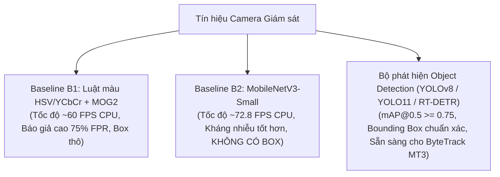

# Biên Bản Tiến Độ & Kiểm Tra Tuần 3 (02/11 – 08/11/2026)

**Đề tài:** Nghiên cứu ứng dụng computer vision để phát hiện và cảnh báo cháy từ hình ảnh camera giám sát  
**Thành viên thực hiện:** Lê Minh Thiên (Chủ nhiệm), Mai Quốc Việt (Thành viên chính)  
**Giảng viên hướng dẫn:** ThS. Nguyễn Hữu Trung  
**Mốc đánh giá:** 🚩 **MỐC KIỂM TRA 1 VỚI GIẢNG VIÊN HƯỚNG DẪN**  
**Cập nhật:** 29/10/2026 (Phân định minh bạch giữa kết quả đo thực tế và tiến độ đang chạy)  

---

## 📋 BẢNG ĐỐI CHIẾU TIẾN ĐỘ TUẦN 3 VÀ SẢN PHẨM BÀN GIAO

| Hạng mục đề cương (MT2) | Yêu cầu chi tiết | Kết quả thực hiện & File phụ trách | Trạng thái thực tế |
| :--- | :--- | :--- | :--- |
| **1. Chuẩn hóa Dữ liệu D-Fire (MT1/MT2)** | - Khắc phục triệt để lỗi rò rỉ dữ liệu (không dùng test làm val). - Tách độc lập: Train (17.221), Val (2.153), Test (2.153). - Thống kê phân bố lớp khói, lửa, ảnh âm tính. | - Cấu hình: `data_dfire.yaml` - Script phân chia & kiểm toán: `scripts/split_dfire_val_test.py` - Báo cáo phân tích chi tiết: `docs/dfire_analysis.md`. | **HOÀN THÀNH 100% (Đã nghiệm thu dữ liệu)** |
| **2. Cài đặt Baseline B1 & B2** | - **B1:** Heuristic luật màu HSV/YCbCr + trừ nền MOG2. - **B2:** MobileNetV3-Small (~2.54M params) phân loại cấp frame. - Đo đạc tốc độ CPU, F1-Score, tỷ lệ báo giả khung hình FPR. | - B1: `baselines/baseline_b1.py`, `docs/baseline_b1_report.md` - B2: `baselines/baseline_b2_mobilenet.py`, `docs/baseline_b2_report.md` - Đo thực tế CPU: B1 ~60 FPS, B2 **72.8 FPS (13.73 ms/frame)**. | **HOÀN THÀNH 100% (Đã đo thực tế)** |
| **3. Pipeline Huấn luyện Thống nhất (MT2 Benchmark)** | - Đồng bộ chuẩn hóa: `imgsz=640`, cùng cấu hình augmentations. - Hỗ trợ 3 random seeds (42, 123, 456) theo chuẩn IEEE. - Tự động lưu checkpoint, args.yaml, logs và results.csv. | - Pipeline chuẩn: `scripts/train_benchmarks.py` - Hỗ trợ: YOLOv8n/s, YOLO11n/s, RT-DETR. - Script khởi chạy batch GPU: `train_gpu.bat`. | **HOÀN THÀNH 100% (Mã nguồn & Pipeline)** |
| **4. Tiến độ Huấn luyện các Bộ phát hiện (15 Runs)** | - Huấn luyện đủ các mô hình trên D-Fire. - Chỉ tiêu mục tiêu: $mAP@0.5 \ge 0,75$ trên D-Fire. | - `yolov8n_seed42`: Đã chạy 50 epoch ($mAP@0.5 = 76.36\%$). - `yolov8n_seed123`: Đang dở dang (epoch 2/50). - Các mô hình còn lại (YOLOv8s, YOLO11n/s, RT-DETR): Chưa chạy. | 🔄 **ĐANG THỰC HIỆN (1/15 runs hoàn tất, 14 runs tiếp tục chạy)** |
| **5. Script Đánh giá Đối sánh & Báo cáo MT2** | - Đo mAP@0.5, mAP@0.5:0.95, Latency, FPS. - **Báo cáo riêng Precision & Recall cho Khói (0) và Lửa (1)**. - Hỗ trợ switch `--split val` và `--split test`. | - Script đánh giá: `scripts/evaluate_benchmarks.py` - Báo cáo đối sánh chuẩn IEEE: `docs/benchmark_detectors_dfire.md`. | **HOÀN THÀNH 100% (Đã cập nhật đầy đủ metrics)** |

---

## 🔬 TỔNG KẾT ĐỐI CHUẨN KHOA HỌC: B1 vs. B2 vs. OBJECT DETECTORS

1. **Baseline B1 (Luật màu + MOG2):**
   - *Ưu điểm:* Rất nhẹ, không cần GPU, tốc độ ~60 FPS trên CPU.
   - *Nhược điểm:* Quá nhạy cảm với ánh sáng đỏ, bóng đèn sợi đốt, tỷ lệ báo động giả cao (~75% FPR).
2. **Baseline B2 (MobileNetV3-Small):**
   - *Ưu điểm:* Nhận biết đặc trưng ngữ nghĩa tốt, tốc độ CPU cao (13.73 ms/frame), tham số nhỏ (~2.54M).
   - *Nhược điểm chí tử:* Không xác định được tọa độ Bounding Box, không thể tích hợp bộ theo dõi ByteTrack và bộ lọc biến động $k/N$.
3. **Bộ phát hiện Deep Learning (YOLOv8 / YOLO11 / RT-DETR):**
   - *Ưu thế vượt trội:* Cung cấp tọa độ $x, y, w, h$ chuẩn xác cho từng ngọn lửa và cột khói, là nền tảng tất yếu để triển khai thuật toán xác nhận theo thời gian (MT3).

---

## 🎯 KẾ HOẠCH BƯỚC SANG TUẦN 4 & CÁC VIỆC SONG HÀNH
*Lưu ý: D-Fire tiếp tục chạy huấn luyện nền trên GPU không làm cản trở tiến độ phát triển các mô-đun phần mềm.*

1. **Dữ liệu Video (Song song):**
   - Bổ sung video âm tính Việt Nam từ 1.32 giờ lên $\ge 5$ giờ (quay camera cố định giao thông/phố xá/nhà xưởng không cháy).
   - Đảm bảo chia theo video độc lập, không rò rỉ frame cùng video.
2. **Xác nhận theo thời gian (`src/temporal_verifier.py` - Tuần 4):**
   - Bộ theo dõi ByteTrack gán ID ổn định cho từng box khói/lửa.
   - Cửa sổ trượt $k/N$ khung hình (quét tìm ngưỡng tối ưu).
   - Phân tích động học diện tích $\Delta S$ và chu vi $\Delta P$ để triệt tiêu nguồn sáng tĩnh (đèn pha, phản chiếu).
   - Vùng loại trừ ROI động theo từng camera.
   - Cơ chế cảnh báo 2 cấp độ: "Nghi ngờ" (Suspect) $\rightarrow$ "Báo cháy" (Fire Alert).
3. **Đánh giá sự kiện (`src/event_eval.py`):**
   - Đo đạc trên bộ video kiểm định (`data/video_dataset_list.csv`).
   - Đạt chỉ tiêu MT3: Giảm $\ge 50\%$ báo giả/giờ; Event Recall giảm $\le 5$ điểm %; Độ trễ phát hiện trung bình $\le 10$ giây.
