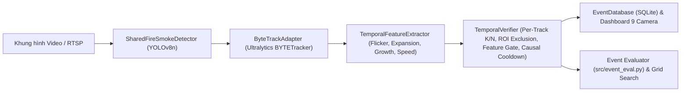

# Tài Liệu Kỹ Thuật Tuần 4: Tích Hợp ByteTrack, Xác Nhận Theo Thời Gian (K/N) & Đánh Giá Theo Sự Kiện

## 1. Tổng Quan Kiến Trúc Pipeline Tuần 4

Hệ thống xác nhận cháy/khói theo chuỗi thời gian (Temporal Verification Pipeline) đã được hoàn thiện và tích hợp trực tiếp vào luồng xử lý đa camera (`src/camera_manager.py`) cũng như bộ công cụ đánh giá sự kiện chuẩn hóa (`src/event_eval.py`):

---

## 2. Chi Tiết Các Mô-đun Cốt Lõi

### 2.1. `src/bytetrack_adapter.py` — Bộ Điều Hợp ByteTrack Chính Thức
- **Thư viện gốc:** `ultralytics.trackers.byte_tracker.BYTETracker` kết hợp `lap` (`linear_assignment`).
- **Liên kết 2 giai đoạn (Two-stage Association):**
  1. Giai đoạn 1: Khớp các detection có độ tin cậy cao ($\ge$ `track_high_thresh`) với các track đang hoạt động bằng khoảng cách IoU + Kalman Filter.
  2. Giai đoạn 2: Khớp các detection có độ tin cậy thấp (`track_low_thresh` $\le \text{conf} <$ `track_high_thresh`) với các track bị che khuất tạm thời để ngăn đứt gãy ID khi khói loãng hoặc lửa chập chờn.
- **Tách biệt theo lớp (`per_class=True`):** Duy trì thực thể `BYTETracker` độc lập cho `SMOKE` (`cls_id=0`) và `FIRE` (`cls_id=1`), đảm bảo khói bốc lên từ ngọn lửa không bao giờ chiếm đoạt hoặc ghi đè `track_id` của đám cháy.
- **Tham số cấu hình (`ByteTrackSettings` trong `src/config.py`):**
  - `track_high_thresh = 0.5` (`0.35` trong chế độ benchmark lấy mẫu `5.0 FPS`)
  - `track_low_thresh = 0.1`
  - `new_track_thresh = 0.6` (`0.40` ở `5.0 FPS`)
  - `track_buffer = 30` khung hình (`15` ở `5.0 FPS`)
  - `match_thresh = 0.8` (`0.70` ở `5.0 FPS`)
  - `fuse_score = False`

### 2.2. `src/temporal_features.py` — Trích Xuất Đặc Trưng Động Học Thời Gian
- Với mỗi `track_id` được duy trì bởi ByteTrack, `TemporalFeatureExtractor` lưu lịch sử cửa sổ trượt (`history_size = 12`) và tính toán 5 đặc trưng vật lý:
  1. `area_growth_rate`: Tốc độ nở rộng diện tích chuẩn hóa theo giây.
  2. `centroid_speed`: Vận tốc dịch chuyển tâm vùng cháy/khói.
  3. `roi_intensity_variance`: Phương sai cường độ sáng bên trong hộp giới hạn (ROI).
  4. `flicker_score`: Hệ số biến thiên độ sáng ($\sigma / \mu$) đặc trưng cho tần số nhấp nháy của ngọn lửa.
  5. `smoke_expansion_score`: Tổng tích lũy mức tăng trưởng dương của diện tích đám khói.
- Hàm `compute_dynamic_feature_score(feat)` trong `src/temporal_verifier.py` tổng hợp các đặc trưng trên thành điểm biến động động học `temporal_score` để lọc bỏ các vật thể tĩnh có màu giống lửa (đèn báo, biển hiệu màu đỏ/cam).

### 2.3. `src/temporal_verifier.py` — Xác Minh Cửa Sổ Trượt K/N Theo Từng Track ID
- **Cửa sổ trượt K/N theo từng `track_id` và từng lớp (`FIRE` / `SMOKE`):**
  - Mỗi `TrackState` lưu danh sách chỉ số khung hình xuất hiện `seen_frames` trong khoảng `[frame_idx - N + 1, frame_idx]`.
  - Tuyệt đối không cộng dồn số lần xuất hiện của các `track_id` rời rạc (nhiễu lốm đốm ở các vị trí khác nhau) và không gộp chung số khung hình của `FIRE` với `SMOKE`.
- **Bảo toàn `track_id` từ ByteTrack:** Khi `tracks_assigned=True`, phương thức `_record_external_tracks()` giữ nguyên vẹn `track_id` của ByteTrack.
- **Vùng loại trừ (`exclusion_zones`):** Loại bỏ ngay từ đầu các bounding box có tâm $(x_c, y_c)$ rơi vào vùng cấm đã cấu hình riêng cho từng camera.
- **Cổng đặc trưng động học (`feature_threshold`):** Một track chỉ được nâng lên mức `FIRE` khi đạt đồng thời $\text{hits} \ge K$ trong $N$ khung gần nhất **và** điểm biến động trung bình `temporal_score >= feature_threshold`.
- **Cooldown nhân quả (`timestamp_sec`):** Khởi tạo `last_alert_timestamp = None` để không bao giờ chặn cảnh báo hợp lệ ở những giây đầu tiên của video; nhận trực tiếp `timestamp_sec` của khung hình hiện tại để vừa chống phát cảnh báo lặp trong khoảng `cooldown_sec`, vừa cho phép kích hoạt cảnh báo cho sự kiện mới ngay sau khi hết thời gian Cooldown.

### 2.4. `src/camera_manager.py` — Cô Lập Trạng Thái Đa Luồng 9 Camera
- Mỗi `CameraStreamWorker` sở hữu riêng biệt:
  - `self.tracker = ByteTrackAdapter(...)`
  - `self.features_extractor = TemporalFeatureExtractor(...)`
  - `self.verifier = TemporalVerifier(...)`
- Trong vòng lặp `_infer_loop()`, worker truyền `feature_map` và `timestamp_sec` trực tiếp vào `self.verifier.update(boxes, tracks_assigned=True, feature_map=feature_map, timestamp_sec=now_ts)`.
- Khi camera kết nối lại (`RECONNECTING`), đổi nguồn phát hoặc tua lại từ đầu video, cả 3 thành phần (`tracker`, `features_extractor`, `verifier`) đều được gọi `.reset()` đồng bộ, đảm bảo không rò rỉ trạng thái cũ.

### 2.5. `src/event_eval.py` (và wrapper `src/week4_event_eval.py`) — Công Cụ Đánh Giá Theo Sự Kiện
- Triển khai chính thức tại `src/event_eval.py` (`src/week4_event_eval.py` đóng vai trò wrapper tương thích ngược để không trùng lặp mã nguồn).
- Tách biệt rõ ràng:
  - `extract_frame_level_alarms()` & `merge_frame_alarms_to_events()`: Xây dựng **Pipeline A (Frame-level baseline)** thuần túy từ kết quả detector cấp khung hình (không dùng ByteTrack, không dùng K/N, không dùng Cooldown).
  - `frame_detections_to_events()`: Chuyển đổi dữ liệu khung hình sang cả sự kiện Frame-level baseline và sự kiện Temporal-confirmed.
  - `evaluate()`: Tính toán chính xác `video_event_recall`, `event_instance_recall`, `event_precision`, `event_f1`, `mean_detection_delay_sec`, và `false_alarms_per_hour` (FAR).
  - **Quy tắc nghiêm ngặt cho FAR:** Nếu thiếu dữ liệu video âm tính (`negative_video_ids` rỗng hoặc `negative_hours <= 0`), mặc định ném `ValueError` (`allow_missing_negative=False`) hoặc trả về `false_alarms_per_hour = None` kèm `status = "BLOCKED_BY_NEGATIVE_DATA"` (`allow_missing_negative=True`). Tuyệt đối không tính FAR từ video dương tính và không tự gán `FAR = 0.0`.
  - `grid_search()` & `select_best_operating_point()`: Quét lưới tham số `(confidence_threshold, K, N, feature_threshold, cooldown_sec)` trên tập Validation và tự động kết luận `NO_FEASIBLE_OPERATING_POINT` khi thiếu dữ liệu âm tính.
